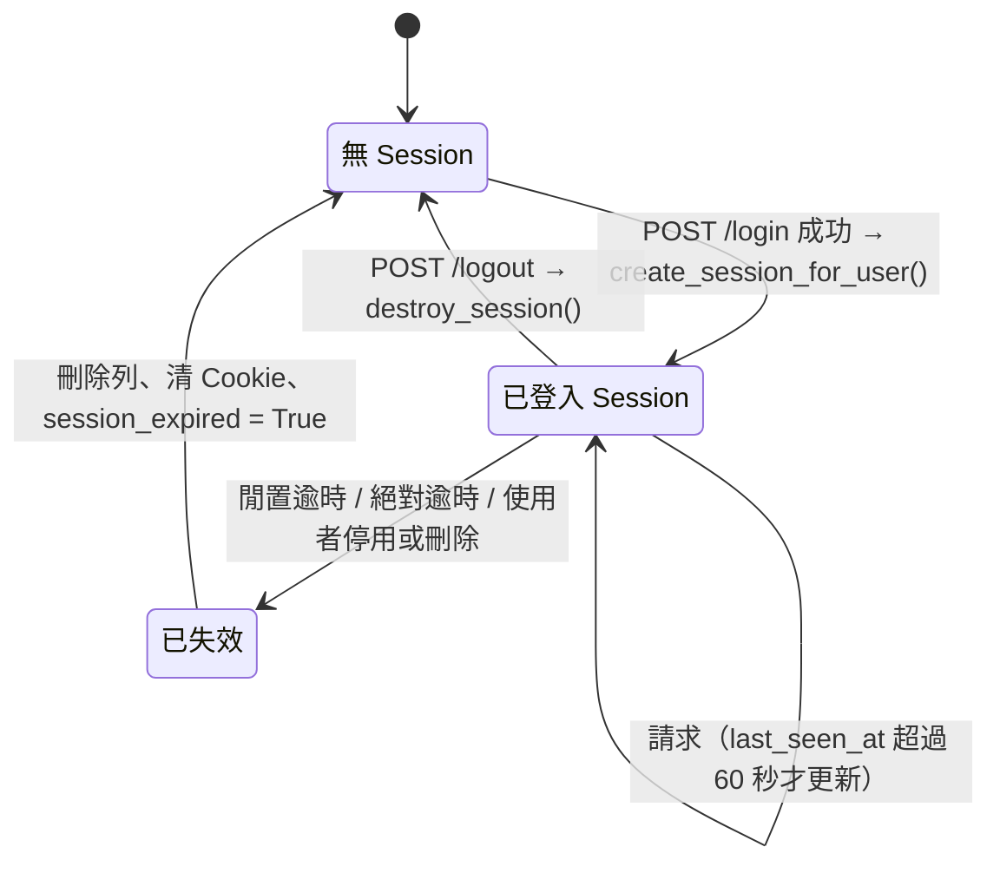

# ADR-001 Server-side Session(伺服器端會話) 儲存方式

- 狀態：Proposed(提議)（待 T-001 設計審查通過後改為 Accepted）
- 日期：2026-11-06（第 2 版：依 Code Review / Security Review 修訂。第 3 版：pop_flashes 無 flash 不寫入、略過 /static 與 /healthz、Cookie 共用 helper、清理由 T-008 成功路徑觸發）
- 決策者：System Analyst；審查：Security Reviewer
- 相關：US-013 AC1、AC5～AC8；US-014 AC5、AC6（未來）；T-005、T-007、T-008；ASVS 5.0 V7（Session Management，Level 2）；ADR-002（登入前 CSRF）

## 背景

AGENTS.md 2.3 要求：Cookie `HttpOnly`、`SameSite=Lax`、正式環境 `Secure`；登入後重新產生 Session ID；登出時銷毀；設定閒置逾時。US-014 未來還要求「停用帳號、重設密碼時該使用者既有 Session 立即失效」。CSRF Token（ADR-002）需要綁定在已登入 Session 上。

## 選項

| 選項 | 說明 | 優點 | 缺點 |
|---|---|---|---|
| A. Starlette `SessionMiddleware`（簽章 Cookie） | 資料以 itsdangerous 簽章後整包放在 Cookie | 零資料表、官方內建 | **伺服器端無法銷毀**：登出只能請瀏覽器刪 Cookie，被竊取的 Cookie 在簽章到期前仍有效（違反「登出時銷毀」）；無法「使某使用者所有 Session 失效」（US-014）；閒置逾時無法防重放；內容僅 base64；「重新產生 Session ID」沒有意義 |
| B. **伺服器端 Session 存 SQLite**（自建） | Cookie 只放隨機 token，Session 資料存 `user_sessions` 表 | 可銷毀、可依使用者批次失效、逾時在伺服器端強制；沿用 SQLite 與 Alembic；無新增相依 | 每個請求一次讀取、最多每 60 秒一次寫入；需自行實作並完整測試 |
| C. 記憶體 dict | | 最簡單 | 重啟即全部登出；多 worker 不共享 |
| D. Redis 等外部儲存 | | 效能好、內建 TTL | 新增基礎設施，違反單機 SQLite 技術棧 |
| E. 第三方套件（如 `starsessions`） | 可插拔 backend | 少寫部分程式 | 仍需自寫 SQLite backend、輪換與依使用者失效；多一個相依 |

## 決策

採用 **B：伺服器端 Session 存 SQLite**，自建於 `app/core/session.py`（middleware 與 API）與 `app/core/session_store.py`（資料存取），資料表 `user_sessions`（erd.md 3.7）。**不使用** Starlette `SessionMiddleware`；`itsdangerous` 若無其他用途，T-003 移除。

**只有已登入使用者才有伺服器端 Session**（第 2 版變更）。登入前的 CSRF 防護改用無狀態 HMAC Token（ADR-002 第 4 節），未登入請求**不會寫入 DB**，消除匿名請求灌爆 `user_sessions` 的 DoS 風險（Security Review N-1）。

### 1. Token 與儲存

- Session token：`secrets.token_urlsafe(32)`（256 bits 熵，43 字元）。Cookie 只存 token 原文。
- DB 只存 `id_hash = sha256(token).hexdigest()`；查詢以雜湊比對（DB 或備份外流時無法直接用來登入）。
- Cookie 值長度 ≠ 43 或含 `[A-Za-z0-9_-]` 以外字元 → 視為無 Session（不查 DB）。

### 2. Cookie 屬性

| 屬性 | 值 |
|---|---|
| 名稱 | `SESSION_COOKIE_NAME`；**production 必須以 `__Host-` 開頭，否則 `Settings` 驗證失敗、無法啟動**（Security Review N-7）。`__Host-` 前綴強制 `Secure`、`Path=/`、無 `Domain`，防止子網域注入 Cookie；**名稱以 `__Host-` 開頭時（不論環境）`SESSION_COOKIE_SECURE` 必須為 true**（Code Review m-2） |
| `HttpOnly` | 一律 |
| `SameSite` | `Lax` |
| `Secure` | `SESSION_COOKIE_SECURE`；production 為 false → 啟動失敗 |
| `Path` | `/` |
| `Domain` | 不設定 |
| `Max-Age` / `Expires` | 不設定（瀏覽器關閉即失效）；逾時一律由伺服器端判斷 |

### 3. 生命週期

- **載入**（每個請求，`ServerSessionMiddleware`）：
  1. 讀 Cookie → 雜湊 → **唯讀交易**查 `user_sessions` JOIN `users`，查完即結束交易。
  2. 判斷失效：`now - last_seen_at > SESSION_MAX_AGE_SECONDS`（閒置）、`now - created_at > SESSION_ABSOLUTE_MAX_AGE_SECONDS`（絕對）、使用者不存在或 `is_active=false`。失效 → 以 `immediate_transaction` 刪除該列、回應清除 Cookie、設 `request.state.session_expired = True`、記錄 `auth.session.expired`。
  3. Cookie 有合法格式 token 但查無資料列（已被清理或已登出）→ 回應清除 Cookie，並設 `session_expired = True`（使用者看到「登入已逾時」，不洩漏資訊）。
  4. 有效 → `request.state.session: ServerSession`、`request.state.current_user: CurrentUser`；未登入時兩者為 `None`。
  5. `now - last_seen_at >= 60 秒` 才以 `immediate_transaction` 寫回 `last_seen_at`（降低寫入競爭）。實際閒置判定可能提前最多 60 秒；測試以「閒置 1801 秒必定失效、閒置 1700 秒必定有效」驗證。
- **`require_login`**：`current_user is None` → `LoginRequired(next_path, timed_out=request.state.session_expired)` → `303 /login?next=...&reason=timeout`。
- **`create_session_for_user(request, response, user_id: int) -> ServerSession`**（登入成功，防 Session Fixation，CWE-384）：在一個 `immediate_transaction` 中刪除請求帶來的舊 Session 列（若有）、建立新列（新 token、新 `csrf_token`、`created_at = last_seen_at = now`）；回應設定新 Cookie。登入前 Cookie（nonce）與 Session ID 完全無關，攻擊者無法預先固定 Session ID。
- **`destroy_session(request, response) -> None`**（登出）：`immediate_transaction` 刪除資料列；以 `delete_secure_cookie` 回應 `Set-Cookie: <name>=; Max-Age=0; Path=/; HttpOnly; SameSite=Lax[; Secure]`。無有效 Session 時拋 `CSRFError(reason='no_session')`（routes.md 2.2）。
- **`SessionStore.delete_for_user(user_id: int) -> int`**：刪除該使用者所有 Session（US-014 停用 / 重設密碼、US-015 變更密碼時呼叫；Sprint 1 先提供並測試）。
- **Flash**：`add_flash(request, level, text)` / `pop_flashes(request) -> list[FlashMessage]`，存於 `data` JSON。
  - `add_flash`：以 `immediate_transaction` 讀改寫（在寫入交易內重讀 `data`，避免覆蓋同時寫入的其他 flash）。
  - `pop_flashes`（Code Review m-3）：**先看 middleware 已載入的 `ServerSession.data`**；沒有 flash 時直接回傳空 list，**不開任何交易**。有 flash 時才以 `immediate_transaction` 重讀並清空 `flashes` 再回傳。因此一般頁面渲染不會產生寫入。
  - 未登入時 `add_flash` 為 no-op、`pop_flashes` 回傳空 list（Sprint 1 沒有需要對未登入者顯示 flash 的流程）。

### 4. 交易方式（Code Review #1）

WAL 模式下「先讀後寫」的 deferred 交易在升級寫鎖時可能立即 `SQLITE_BUSY_SNAPSHOT`（不經 busy_timeout）。因此本模組所有寫入一律使用 `immediate_transaction`（ADR-003 第 2.1 節）：

| 操作 | 交易 |
|---|---|
| middleware 讀取 Session | 唯讀 deferred 交易，查完即 commit/close |
| middleware 刪除失效列 / 更新 `last_seen_at` | 另開 `immediate_transaction`（重新以 `id_hash` 定位，列已不存在則忽略） |
| `create_session_for_user`、`destroy_session`、`add_flash`、`delete_for_user`、`delete_expired` | 各自 `immediate_transaction` |
| `pop_flashes` | 已載入的 `data` 無 flash → 不開交易；有 flash → `immediate_transaction` 重讀並清空 |

- `SessionStore` 每次操作使用自己的短生命週期 DB Session（`session_factory()`，用完即關），**不共用**請求的 `get_session()`，避免把 Session 存取的交易帶進 service 的交易（ADR-003）。
- middleware 為 async，DB 存取一律以 `starlette.concurrency.run_in_threadpool` 呼叫同步的 `SessionStore`，避免阻塞 event loop。

### 5. 清理

- `SessionStore.delete_expired(now, idle_seconds, absolute_seconds) -> int`：刪除 `last_seen_at < now - idle` 或 `created_at < now - absolute` 的列。
- 觸發與負責 Task：**由 T-008 `AuthService.maybe_cleanup(now)`** 統一觸發——在 `authenticate` 的 `reserve_attempt` 之後呼叫（不論登入成功或失敗），同時執行 `SessionStore.delete_expired` 與 `LoginThrottleRepository.delete_stale`；同一程序內最多每 300 秒一次（模組常數 `SESSION_CLEANUP_MIN_INTERVAL_SECONDS = 300`）。第 3 版「成功路徑清 Session、reserve 路徑清 throttle、共用時間戳」會使 Session 清理被餓死，已修正（ADR-005 第 5 節）。`create_session_for_user` 本身不清理，保持單一職責。不需排程器。`delete_expired` 本身由 T-007 提供。
- 由於只有已登入 Session 寫入 DB，資料量上限約為「同時登入人數」。

### 6. 實作要點（T-007）

- `ServerSessionMiddleware` 為**純 ASGI middleware**（不用 `BaseHTTPMiddleware`）；順序見 overview.md 第 2 節（最內層）。
- **略過路徑（Code Review n-4）**：`/static/` 開頭與 `/healthz` 不讀 Cookie、不查 DB，`request.state.session` / `current_user` 設為 `None`、`session_expired=False`。
- Session Cookie 的設定與刪除一律使用 `app/core/cookies.py` 的 `set_secure_cookie` / `delete_secure_cookie`（ADR-002 4.5），確保刪除時帶相同的 `Path` / `Secure` / `HttpOnly` / `SameSite`（`__Host-` Cookie 缺任一屬性時瀏覽器會拒絕刪除）。
- `CurrentUser`（`app/core/identity.py`）、`ServerSession`、`FlashMessage`（`app/core/session.py`）由 T-007 建立（overview.md 3.1）。
- 樣板注入：context processor 讀 `request.state.current_user`、`request.state.session.csrf_token`（routes.md 第 3 節）。
- 日誌禁止記錄 token、`id_hash`、`csrf_token`。

### 7. 測試（T-007、T-021）

Cookie 屬性（含 production `Secure` 與 `__Host-` 名稱驗證；刪除用 `Set-Cookie` 含 `Secure`、`Path=/`）、無 flash 的頁面渲染不產生寫入交易（以 `before_cursor_execute` 斷言沒有 `BEGIN IMMEDIATE`）、`/static/*` 與 `/healthz` 不查 `user_sessions`、登入前後 Session ID 不同、登出後舊 Cookie 被導向登入、閒置 / 絕對逾時、停用使用者的 Session 下一個請求即失效、未登入瀏覽公開頁面後 `user_sessions` 筆數為 0。

## 影響

- 正面：符合 AGENTS.md 2.3 Session 全部強制項與 ASVS L2 V7；未登入請求不寫 DB；US-014 的「使所有 Session 失效」已有基礎。
- 負面：每個已登入請求多一次 DB 讀取；需自行維護安全關鍵程式碼 → T-007 必須有完整負面測試，並經 Security Reviewer 審查。
- 新設定：`SESSION_ABSOLUTE_MAX_AGE_SECONDS`；production 對 `SESSION_COOKIE_NAME` 的前綴驗證。不需新增套件。
