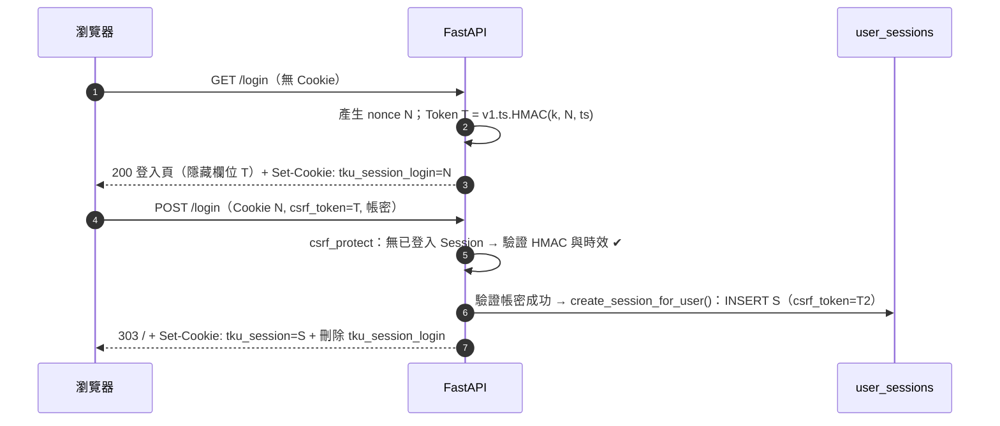

# ADR-002 CSRF Token 機制

- 狀態：Proposed（待 T-001 設計審查通過後改為 Accepted）
- 日期：2026-11-06（第 2 版：登入前改用無狀態 HMAC Token；移除標頭傳遞。第 3 版：修正表單解析限制〔Content-Type 白名單＋自訂 Request〕、nonce 改 Lax 並每次刷新、Cookie 共用 helper、`derive_key`、`no_nonce`。第 4 版：`ALL_ROUTERS` 與不依賴 FastAPI 內部的覆蓋測試、route_class 套用規則、重複 Content-Type、共用 `SAFE_METHODS`、記錄實測版本）
- 相關：US-013 AC5、AC8；US-017 AC7；US-004 AC2、AC16；T-007、T-010、T-021；CWE-352；ASVS 5.0 V3.5

## 背景

AGENTS.md 2.3：所有會改變狀態的表單與請求都必須驗證 CSRF Token。全站為 SSR 表單、不依賴 JavaScript。登入表單在使用者尚未登入時也需防護（Login CSRF：攻擊者讓受害者登入攻擊者的帳號）。

第 1 版以「匿名伺服器端 Session」承載登入前 Token，Security Review 指出（N-1）：任何人只要不斷 `GET /login` 就能讓 `user_sessions` 無限成長（DoS）。

## 選項

已登入：

| 選項 | 評估 |
|---|---|
| A1. **Synchronizer Token，綁定伺服器端 Session** | OWASP 首選；已有伺服器端 Session（ADR-001），實作簡單 |
| A2. Signed Double-Submit Cookie | 不需伺服器狀態，但我們已有狀態，沒有好處 |

登入前：

| 選項 | 評估 |
|---|---|
| B1. 匿名伺服器端 Session（第 1 版） | 未登入請求寫 DB → DoS 風險（N-1） |
| B2. 匿名 Session ＋ 限制建立頻率 / 數量 | 需要 IP 計數等額外狀態，仍會寫 DB，邏輯複雜 |
| B3. **無狀態 Signed Double-Submit：nonce Cookie ＋ HMAC Token** | 不寫 DB；Token 綁定瀏覽器持有的 nonce，攻擊者無法替受害者產生有效組合；使用 `SECRET_KEY` |
| B4. 只靠 `SameSite` + `Origin` 檢查 | 不符 AGENTS.md「必須驗證 Token」 |

套件：`fastapi-csrf-protect`（需每個 route 手動呼叫，非預設拒絕）、`starlette-csrf` / `asgi-csrf`（以 header 為主，不綁定我們的 Session）——皆不採用。

## 決策

- **已登入：A1**（Token 存 `user_sessions.csrf_token`）。
- **登入前：B3**（無狀態 HMAC，登入成功才建立伺服器端 Session）。評估 B3 沒有重大缺點：唯一代價是 `SECRET_KEY` 成為必要秘密（已有強度驗證），以及金鑰更換時未送出的登入表單失效（影響輕微，見第 4.4 節）。
- 兩者皆由同一個**全域相依** `csrf_protect` 驗證，預設套用到所有 route；不新增套件。
- Token **只**經由表單隱藏欄位 `csrf_token` 傳遞；不接受 `X-CSRF-Token` 等標頭（Sprint 1 無 JS 需求，Code Review #15），未來需要時另立 ADR。

### 1. 已登入 Token

- 建立 Session 時產生 `secrets.token_urlsafe(32)`；每個 Session 一個 Token（per-session），登入時（`create_session_for_user`）必為新值，登出時隨 Session 刪除。
- 不放 URL、不寫日誌、不放 Cookie。

### 2. 驗證：全域相依 `csrf_protect`（`app/core/csrf.py`，T-007）

```python
from app.core.forms import SAFE_METHODS   # 唯一定義：frozenset({'GET', 'HEAD', 'OPTIONS', 'TRACE'})，FormContentTypeMiddleware 共用

async def csrf_protect(request: Request, clock: Clock = Depends(get_clock)) -> None:
    """全域相依：非安全方法一律驗證 CSRF Token；失敗拋 CSRFError（→ 403）。"""
    if request.method in SAFE_METHODS:
        return
    form = await request.form()            # 取得 FastAPI 已解析並快取的表單（限制見 2.1）
    value = form.get('csrf_token')
    submitted = value if isinstance(value, str) else ''
    if not submitted:
        raise CSRFError(reason='missing')
    session: ServerSession | None = getattr(request.state, 'session', None)
    if session is not None:                                   # 已登入：Synchronizer Token
        if not hmac.compare_digest(submitted.encode(), session.csrf_token.encode()):
            raise CSRFError(reason='mismatch')
        return
    verify_login_csrf_token(request, submitted, now=clock.now_utc())   # 未登入：無狀態 Token（第 4 節）
```

- 時間一律來自 `Clock`（Code Review m-4），測試可固定時間驗證 Token 過期。
- 掛載：`FastAPI(dependencies=[Depends(csrf_protect)])`。App 層級相依在 router / endpoint 相依**之前**執行，因此 CSRF 一定先於 `require_login`、`require_role` 與表單 schema 驗證；未來新增的 POST route 自動受保護（預設拒絕）。
- 豁免：Sprint 1 **沒有**任何豁免 route；未來需要須另立 ADR。
- 失敗：`CSRFError` → `403` `errors/403.html`「表單已失效，請重新整理頁面後再試」（附回首頁連結），由 handler 記錄 `csrf.failed`；不執行任何狀態變更。
- `/logout`：除了 `csrf_protect`，route 另要求必須有有效的已登入 Session，否則 `CSRFError(reason='no_session')` → 403（不接受以登入前 Token 登出）。

### 2.1 表單解析的限制（Code Review B-1，第 3 版修正）

**第 2 版的敘述是錯的**：FastAPI 對有 `Form()` 參數的 route，會在執行 dependency（含 `csrf_protect`）**之前**就以 Starlette 預設限制（`max_fields=1000`、`max_files=1000`）解析表單並快取在 `request._form`；之後在 dependency 中呼叫 `request.form(max_fields=..., max_files=0)` 會直接回傳快取值、**忽略新參數**（Code Reviewer 以 FastAPI 0.162.0 / Starlette 1.10.0 實測：限制 2 欄位仍接受 6 欄位、multipart 夾檔仍 200）。因此限制不能放在 `csrf_protect`，改為兩層：

1. **Content-Type 白名單（純 ASGI `FormContentTypeMiddleware`，`app/core/middleware.py`，T-023）**：
   - 適用範圍：`method not in SAFE_METHODS`（與 `csrf_protect` 共用 `app/core/forms.py` 的同一個常數，Security Review NB-C）。
   - 解析：取 ASGI `headers` 中名稱為 `content-type` 的值；**出現多於一個 `Content-Type` 標頭 → 400**（純文字，不猜測哪一個有效）。單一值以 `python_multipart.multipart.parse_options_header`（Starlette `Request.form()` 判斷表單類型時使用的同一函式；`python-multipart` 已在相依清單）解析，主類型不分大小寫比對，忽略 `charset` 等參數。
   - 主類型必須是 `application/x-www-form-urlencoded`，否則回 **415**。例外：本體為空（`Content-Length: 0`，或沒有 `Content-Length` 也沒有 `Transfer-Encoding`）時允許無 `Content-Type`，交給 `csrf_protect` 以「缺少 Token」回 403。
   - Sprint 1 沒有檔案上傳，`multipart/form-data` 一律 415，因此不存在檔案部分（US-007 附件上傳時另立 ADR 放寬）。
2. **欄位數上限（自訂 `Request` / `APIRoute`，`app/core/forms.py`，T-023；`SAFE_METHODS` 同檔，T-007 的 `csrf_protect` 匯入）**：

   ```python
   from collections.abc import Callable, Coroutine
   from typing import Any, Final

   from fastapi import Request, Response
   from fastapi.routing import APIRoute
   from starlette._utils import AwaitableOrContextManager   # 注意：Starlette 私有模組，僅用於與 Request.form() 相同的回傳型別；
                                                             # 升級 Starlette 時需確認仍存在（mypy --strict 已於 1.10.0 驗證）
   from starlette.datastructures import FormData

   SAFE_METHODS: Final = frozenset({'GET', 'HEAD', 'OPTIONS', 'TRACE'})
   FORM_MAX_FIELDS: Final = 50

   class LimitedFormRequest(Request):
       """覆寫 form()：不論呼叫端傳入什麼參數，一律套用專案上限。FastAPI 內部與 csrf_protect 都經過這裡。"""
       def form(self, *, max_files: int | float = 0, max_fields: int | float = FORM_MAX_FIELDS,
                max_part_size: int = 1024 * 1024) -> AwaitableOrContextManager[FormData]:
           return super().form(max_files=0, max_fields=FORM_MAX_FIELDS, max_part_size=max_part_size)

   class LimitedFormRoute(APIRoute):
       def get_route_handler(self) -> Callable[[Request], Coroutine[Any, Any, Response]]:
           original = super().get_route_handler()
           async def handler(request: Request) -> Response:
               # 不傳 send：FastAPI 的 route handler 只透過回傳的 Response 送出回應，不使用 request 的 send
               return await original(LimitedFormRequest(request.scope, request.receive))
           return handler
   ```

   - **route_class 的套用規則（Code Review #2）**：`include_router` **不會**把父層（含 `app.router`）的 `route_class` 套用到子 router 的 route；每個子 router 都必須自己宣告 `APIRouter(route_class=LimitedFormRoute)`。`app.router.route_class = LimitedFormRoute` 只影響直接以 `@app.get` / `@app.post` 註冊的 route（例如 `/healthz`），且必須在任何 `@app.get/post` **之前**設定（`create_app` 第一步）。
   - **`ALL_ROUTERS` 清單（Code Review B-1'）**：`app/routers/__init__.py` 維護 `ALL_ROUTERS: Final[tuple[APIRouter, ...]]`，列出全部 web router；`create_app` **只能**從這份清單 `include_router`（不得在別處 include）。新增 router 時必須加入清單，否則不會被掛載（功能測試會失敗）。
   - 超過上限時 Starlette 拋 `HTTPException(400)` → `errors/400.html`。
   - 欄位數另受 `MAX_REQUEST_BODY_BYTES`（64 KiB）間接限制。
   - **已驗證（Security Review NB-B）**：Code Reviewer 以 FastAPI 0.162.0 / Starlette 1.10.0 / Uvicorn 0.54.0 實測，urlencoded 送 57 欄位，在有與沒有 `Form()` 參數的 route 皆回 400，且 `csrf_protect` 取得的 request 也是 `LimitedFormRequest`；`mypy --strict` 通過。保留下列 51 欄位測試，防止升級後退化。
3. **測試（T-023 建立；T-007 必須涵蓋「有 `Form()` 參數的 route」；預期 POST 清單由 T-010 / T-015 / T-020 各自擴充，T-021 驗收最終清單）**：
   - 對有 `Form()` 參數的 POST route 送 51 個欄位（帶正確 Token）→ 400。
   - `multipart/form-data`（含檔案或不含檔案）→ 415；`application/json` → 415；兩個 `Content-Type` 標頭 → 400；空本體無 Content-Type → 403。
   - **route_class 與 CSRF 覆蓋測試（不依賴 FastAPI 內部結構）**：走訪 `app.router.routes` 加上 `ALL_ROUTERS` 中每個 router 的 `.routes`（**不要**只走訪 `app.routes`——FastAPI 0.162 以 `include_router` 掛載的 route 不會直接出現在其中，子 router 忘了設定 route_class 時測試仍會通過）：
     1. 每個 `APIRoute` 都是 `LimitedFormRoute`。
     2. 每個接受 POST 的 route（路徑參數以 `1` 代入）不帶 Token 送出 → 403。
     3. 收集到的 POST 路徑集合**必須包含**預期清單 `{'/login', '/logout', '/bookings', '/admin/closed-periods', '/admin/closed-periods/{period_id}/edit', '/admin/closed-periods/{period_id}/delete'}`，避免走訪零個 route 時測試悄悄通過。
     - 分工：T-023 提供走訪 helper `iter_api_routes(app, routers=ALL_ROUTERS) -> Iterator[APIRoute]`（`tests/fixtures/`）與測試檔 `tests/integration/test_route_coverage.py`，預期清單常數 `EXPECTED_POST_PATHS` 起始為空、並以**測試用 app** 驗證 helper 本身：一個忘了設定 `route_class` 的子 router 必須被偵測為失敗、`include_router` 掛載的 route 必須被走訪到。T-010（`/login`、`/logout`）、T-015（`/admin/closed-periods*`）、T-020（`/bookings`）實作 route 時把路徑加入 `EXPECTED_POST_PATHS`；T-021 驗收最終清單等於上列集合。
   - `csrf_protect` 讀取表單後，endpoint 的 `Form()` 參數取得相同值。

### 3. 縱深防禦

- `SameSite=Lax` Cookie（Session 與 nonce 皆是，理由見 4.1）。
- 狀態變更只用 POST；GET route 不得有副作用。
- CSP `form-action 'self'`（overview.md 第 8 節）。

### 4. 登入前 Token（無狀態 Signed Double-Submit）

#### 4.1 組成

| 元件 | 內容 |
|---|---|
| nonce Cookie | 名稱 `{SESSION_COOKIE_NAME}_login`（production 為 `__Host-tku_session_login`）；值 `secrets.token_urlsafe(32)`；`HttpOnly`、**`SameSite=Lax`**、`Path=/`、`Secure` 依設定；`Max-Age = LOGIN_CSRF_MAX_AGE_SECONDS`。設定與刪除一律經 `app/core/cookies.py` 的共用 helper（見 4.5） |
| 衍生金鑰 | `k = derive_key('login-csrf')`（`app/core/keys.py`，見 4.4） |
| Token 格式 | `v1.<issued_at>.<mac>`；`issued_at` 為 UTC Unix 秒（十進位整數字串）；`mac = base64url_nopad(HMAC-SHA256(k, b'v1|' + nonce + b'|' + issued_at))` |
| 有效期 | `LOGIN_CSRF_MAX_AGE_SECONDS`（預設 3600） |

**為何 nonce 用 `SameSite=Lax` 而非 Strict（Code Review m-1，第 3 版變更）**：Strict 時，使用者從外站連結（例如學校入口網、Email）進入 `/login`，瀏覽器不送 nonce Cookie，伺服器誤判為「沒有 nonce」而發新的 nonce 覆寫，造成**其他已開啟的登入分頁 Token 失效**。改用 Lax 後，跨站的頂層 GET 導覽會帶 Cookie，nonce 不會被覆寫；而跨站 **POST** 在 Lax 下仍不帶 Cookie，Login CSRF 防護不變（攻擊者的跨站表單送出時缺 nonce → 403）。

#### 4.2 發行：`issue_login_csrf_token(request, response, now) -> str`（`GET /login` 呼叫）

1. 讀 nonce Cookie；格式不合（非 43 字元 base64url）或不存在 → 產生新 nonce。
2. **每次都**以（沿用或新產生的）nonce 重新 `Set-Cookie`，刷新 `Max-Age = LOGIN_CSRF_MAX_AGE_SECONDS`，使 Cookie 壽命與剛發出的 Token 同步（Code Review M-5）。**不更換**既有的有效 nonce，避免多個登入分頁互相使對方的 Token 失效。
3. 以目前時間（`Clock`）產生 Token 回傳，放入表單隱藏欄位。
4. **不寫入任何資料庫。**

#### 4.3 驗證：`verify_login_csrf_token(request, submitted, now) -> None`

1. 沒有 nonce Cookie 或格式不合 → `CSRFError('no_nonce')`（與登出時無 Session 的 `no_session` 區分，Code Review n-3）。
2. Token 不符 `^v1\.[0-9]{1,12}\.[A-Za-z0-9_-]{43}$` → `CSRFError('bad_format')`。
3. 以 nonce 與 `issued_at` 重算 mac，`hmac.compare_digest` 不相等 → `CSRFError('mismatch')`。
4. `now - issued_at > LOGIN_CSRF_MAX_AGE_SECONDS` 或 `issued_at - now > 60`（時鐘偏差容忍）→ `CSRFError('expired')`。
5. 通過。登入成功時 `POST /login` 以共用 helper 刪除 nonce Cookie。

安全性理由：**防護主體是 HMAC 綁定**——Token 只對產生它的 nonce 有效，不知道 `SECRET_KEY` 就無法為受害者的 nonce 產生 mac；攻擊者可從自己的瀏覽器取得「自己 nonce ＋ 自己 Token」，但無法把自己的 nonce Cookie 寫進受害者瀏覽器（`HttpOnly`；production 另有 `__Host-` 前綴阻擋子網域注入）。`SameSite=Lax`（跨站 POST 不帶 nonce）只是**縱深防禦**，即使瀏覽器不支援 SameSite，HMAC 綁定仍成立（Security Review NB-A）。

#### 4.4 `SECRET_KEY` 的用途、金鑰衍生與更換影響（Security Review N-12、NB-7）

- 金鑰衍生統一由 `app/core/keys.py`（T-007 建立）管理，用途標籤集中定義，禁止各模組自行對 `SECRET_KEY` 做 HMAC：

  ```python
  KeyPurpose = Literal['login-csrf']          # 新用途須在此新增並經 Security Reviewer 同意

  def derive_key(purpose: KeyPurpose) -> bytes:
      """HMAC-SHA256(SECRET_KEY, b'tku-venue-booking/' + purpose + b'/v1')；以 lru_cache 快取。"""
  ```

- Sprint 1 中 `SECRET_KEY` **唯一用途**是 `derive_key('login-csrf')`。已登入 Session 與其 Token 為隨機值，不依賴 `SECRET_KEY`。
- 要求：production 長度 ≥ 32，且**不得**為 `FORBIDDEN_SECRET_KEYS`（`app/core/config.py` 常數，至少含 `change-me` 與 `.env.example` 中 `SECRET_KEY` 的範例值）；T-003 以測試解析 `.env.example` 的 `SECRET_KEY` 值並斷言它在 `FORBIDDEN_SECRET_KEYS` 中（範例值變更時測試提醒同步）。以 `secrets.token_urlsafe(64)` 產生。
- 更換（輪替或疑似外洩）：重新部署後，**所有已開啟但尚未送出的登入頁 Token 失效**（使用者送出得到 403，重新整理即可）；**已登入的 Session 不受影響**。因影響輕微，不實作新舊金鑰並存。
- 外洩影響：攻擊者可偽造登入前 Token，但仍需把 nonce 寫入受害者瀏覽器才能發動 Login CSRF；應立即更換金鑰。

#### 4.5 Cookie 設定與刪除的共用 helper（Code Review m-2，`app/core/cookies.py`，T-007）

```python
def set_secure_cookie(response: Response, name: str, value: str, *, max_age: int | None, settings: Settings) -> None:
    """一律 HttpOnly、SameSite=Lax、Path=/、Secure=settings.SESSION_COOKIE_SECURE；max_age=None 為 session cookie。"""

def delete_secure_cookie(response: Response, name: str, *, settings: Settings) -> None:
    """以與 set_secure_cookie 相同的 Path / Secure / HttpOnly / SameSite 送出 Max-Age=0。
    （__Host- Cookie 若刪除時缺 Secure 或 Path，瀏覽器會拒絕該 Set-Cookie，Cookie 不會被刪除。）"""
```

- Session Cookie 與 nonce Cookie 的設定、刪除都只能透過這兩個函式。
- `Settings` 規則：`SESSION_COOKIE_NAME` 以 `__Host-` 開頭時（**不論環境**）`SESSION_COOKIE_SECURE` 必須為 true，否則啟動失敗。
- 測試（Session 與 nonce 兩種 Cookie 都要測，Security Review NB-A）：
  - **設定**用的 `Set-Cookie` 含 `HttpOnly`、`SameSite=Lax`、`Path=/`，`SESSION_COOKIE_SECURE=true` 時含 `Secure`、false 時不含；nonce 另含 `Max-Age=<LOGIN_CSRF_MAX_AGE_SECONDS>`，Session 不含 `Max-Age` / `Expires`。
  - **刪除**用的 `Set-Cookie` 含 `Max-Age=0`、`Path=/`、`HttpOnly`、`SameSite=Lax`，且 `SESSION_COOKIE_SECURE=true` 時含 `Secure`。

#### 4.6 流程



### 5. 與其他 AC 的互動

- **US-004 AC2（未登入 POST 申請）**：沒有 Token / nonce → 403（CSRF 先擋）；帶有效登入前 Token（先 `GET /login` 取得）→ 通過 CSRF，接著 `require_role` → `303 /login`。兩者都不建立申請。T-020 / T-022 兩種情境都要測（Security Review N-13 同意此解讀）。
- **已登入但 Session 逾時後送出表單**：Session 已失效 → 改走登入前驗證 → 沒有 nonce → 403「表單已失效，請重新整理頁面後再試」；重新整理後被 `require_login` 導向登入頁並顯示逾時提示。
- **直接 POST /login 而未先 GET**：沒有 nonce → 403（`no_nonce`，US-013 AC8）。
- **多分頁 / 外站連入（Code Review m-1）**：開啟兩個登入分頁後，再從外站連結（帶跨站 `Referer`、`Sec-Fetch-Site: cross-site`）進入 `/login`，原先兩個分頁的 Token 仍可登入（nonce 未被覆寫）。列入 T-021 情境測試。
- **登入頁停留超過 `LOGIN_CSRF_MAX_AGE_SECONDS`**：Token 過期 → 403（`expired`），重新整理即可（同時刷新 nonce Cookie 壽命）。
- **全路由測試**：所有 POST route 不帶 Token 皆 403，走訪方式與預期清單見 2.1 第 3 點（routes.md 第 1 節）。

## 影響

- 正面：預設拒絕；未登入請求不寫 DB；Login CSRF 受保護；無新增相依。
- 負面：`SECRET_KEY` 成為必要秘密；登入頁停留超過 1 小時需重新整理；所有非安全方法只接受 urlencoded 表單（其他 Content-Type → 415），表單解析受 `MAX_REQUEST_BODY_BYTES` 與 `LimitedFormRequest` 的 `FORM_MAX_FIELDS` 限制（第 2.1 節、error-handling.md 3.1）。
- 新設定：`LOGIN_CSRF_MAX_AGE_SECONDS`。新增模組：`app/core/forms.py`、`app/routers/__init__.py` 的 `ALL_ROUTERS`（T-023）、`app/core/cookies.py`、`app/core/keys.py`（T-007）。
