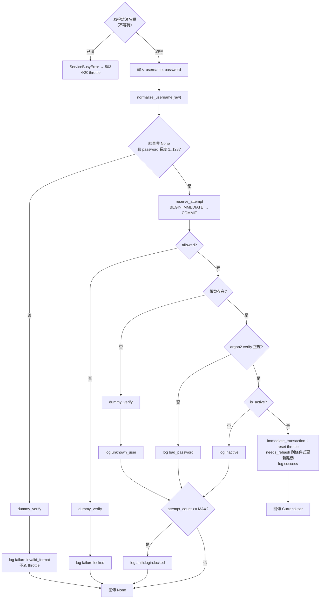

# ADR-005 登入失敗鎖定與密碼雜湊資源限制

- 狀態：Proposed（待 T-001 設計審查通過後改為 Accepted）
- 日期：2026-11-06（第 2 版：改為「先記錄嘗試再驗證」消除 TOCTOU；新增雜湊併發上限與 argon2 參數；新增 CLI 解鎖。第 3 版：雜湊名額改為不等待並先於 reserve_attempt 取得、`normalize_username`、throttle 清理與資料量上界、rehash 條件式更新。第 4 版：單一 `maybe_cleanup`、`slot()` 簽章、名額已滿彙總記錄與 Retry-After）
- 相關：US-013 AC2～AC4、AC10；T-008、T-009、T-010、T-021；CWE-307、CWE-367、CWE-204 / CWE-208、CWE-400；ASVS 5.0 V6（Level 2）

## 背景

- US-013 AC3：同一帳號 15 分鐘內連續失敗 5 次 → 第 6 次即使密碼正確也拒絕，鎖定 15 分鐘；訊息不透露帳號是否存在。
- US-013 AC2：帳號不存在與密碼錯誤顯示相同訊息、回應時間無明顯差異。
- 設定：`LOGIN_MAX_ATTEMPTS=5`、`LOGIN_LOCKOUT_SECONDS=900`（同一值作為時間窗與鎖定時間）。
- 第 1 版「驗證失敗後才記錄」有 TOCTOU 問題（Security Review B-1）：攻擊者同時送出大量請求，全部在任何一筆失敗被記錄前通過鎖定檢查，實際可嘗試的密碼數遠超過 5 次。

## 選項

| 選項 | 評估 |
|---|---|
| A. 在 `users` 表加計數欄位 | 不存在的帳號無法計數 → 行為差異可被用來列舉帳號 |
| B1. 獨立表、驗證失敗後才記錄（第 1 版） | TOCTOU：併發請求可繞過上限 |
| B2. **獨立表 `login_throttles`、在驗證密碼「之前」於寫鎖交易中預先記錄嘗試** | 序列化的「保留名額」使任何時間窗內最多只有 `LOGIN_MAX_ATTEMPTS` 次真正的密碼驗證；帳號是否存在行為一致 |
| C. 以 IP 為鍵的 Rate Limit（`slowapi` 等） | 無法滿足「同一帳號」AC；NAT 下誤傷校園網路；需額外套件。改由反向代理對 `/login` 做 IP 頻率限制作為第二道防線（overview.md 第 7 節） |
| D. 逐筆失敗紀錄表 | 精確滑動時間窗，但資料成長快；AC 只要求固定時間窗 |

## 決策

採用 **B2**：`login_throttles` 表（erd.md 3.8），以通過格式驗證的小寫帳號為鍵，帳號是否存在一律計數；**先記錄嘗試、commit 後才做 argon2 驗證**。不新增套件。

### 1. 嘗試保留：`LoginThrottleRepository.reserve_attempt`

```python
@dataclass(frozen=True, slots=True)
class AttemptReservation:
    allowed: bool              # False = 鎖定中，不得驗證密碼
    attempt_count: int         # 保留後的嘗試數
    locked_until: dt.datetime | None

class LoginThrottleRepository:
    def __init__(self, session: Session) -> None: ...
    def reserve_attempt(self, username: str, now: dt.datetime, max_attempts: int, window_seconds: int) -> AttemptReservation: ...
    def reset(self, username: str) -> None: ...                      # 刪除列（成功登入、CLI 解鎖）
    def delete_stale(self, now: dt.datetime, window_seconds: int) -> int: ...
```

`reserve_attempt` 在**單一 `immediate_transaction`** 中執行（ADR-003 第 2.1 節）：

1. 讀取 `username` 的列；不存在 → 視為 `attempt_count=0`、`window_started_at=now`、`locked_until=NULL`。
2. **時間窗過期重置**：若 `locked_until` 為 NULL 或 `locked_until <= now`，且 `now - window_started_at >= window_seconds` → `attempt_count=0`、`window_started_at=now`、`locked_until=NULL`。
3. **鎖定判斷**：若 `locked_until > now` **或** `attempt_count >= max_attempts` → 不修改計數、不延長鎖定，回傳 `allowed=False`。
4. 否則 `attempt_count += 1`；若 `attempt_count >= max_attempts` → `locked_until = now + window_seconds`。
5. UPSERT 該列（`updated_at=now`），**commit**，回傳 `allowed=True`。

由於 `BEGIN IMMEDIATE` 序列化所有 `reserve_attempt`，同一時間窗內最多只有 `max_attempts` 次回傳 `allowed=True`，即**最多 5 次真正的密碼驗證**，與併發程度無關。

### 2. `AuthService.authenticate` 流程（T-008）

```python
class AuthService:
    def __init__(self, session: Session, settings: Settings, passwords: PasswordService) -> None: ...
    def authenticate(self, username: str, password: str, now: dt.datetime) -> CurrentUser | None:
        """成功回傳 CurrentUser；任何失敗一律回傳 None。原因只寫入安全日誌。
        password 以 str 參數傳入，不經 Pydantic model（overview.md 第 5 節）。"""
```

整個 `authenticate` 包在 `with passwords.slot():` 之內（第 6 節）：**先取得雜湊名額（不等待），才 `reserve_attempt`**。名額已滿 → 立即 `ServiceBusyError`（503），不消耗嘗試次數。



- AC3 驗證：第 1～5 次嘗試各保留一個名額並驗證；第 5 次保留時已設定 `locked_until`。若第 5 次密碼正確 → 成功並刪除列（鎖定隨之解除）；若錯誤 → 鎖定生效並記錄 `auth.login.locked`。第 6 次 → `allowed=False`，即使密碼正確也拒絕。
- 鎖定到期後：時間窗必然已過期（鎖定時間 = 時間窗長度），第 2 步重置，正確密碼可登入。
- **每次嘗試恰好執行一次 argon2 運算**（真實驗證或 `dummy_verify`），使各失敗原因耗時相近（AC2）。
- 停用帳號在**密碼驗證之後**才判斷，避免時間差。
- 格式不符的帳號不寫入 `login_throttles`（不可能存在，不會造成列舉，且避免任意字串塞爆資料表）。
- 密碼長度上限 128：超過者視為格式不符（仍執行 `dummy_verify`），防止超長密碼雜湊 DoS。
- **needs_rehash 的條件式更新（Code Review M-6）**：在成功路徑的 `immediate_transaction` 中執行 `UPDATE users SET password_hash = :new, updated_at = :now WHERE id = :id AND password_hash = :old`（ORM `update()` 帶 bind 參數）；影響 0 列（期間密碼已被他處變更）即放棄，不覆寫較新的雜湊。

### 2.1 帳號正規化：唯一函式 `normalize_username`（Security Review NB-5）

```python
# app/core/security.py（T-008 建立；T-009 之後使用）
_USERNAME_RE: Final = re.compile(r'[a-z0-9._-]{1,50}')

def normalize_username(raw: str) -> str | None:
    """strip → lower → re.fullmatch(_USERNAME_RE)；不符回傳 None。
    以 fullmatch（不用 match + $，避免 '$' 接受結尾換行）。"""
```

- **唯一入口**：`AuthService.authenticate`、`login_throttles` 的鍵、`UserRepository.get_by_username`（只接受已正規化的值）、`AccountService.create_*`、CLI `unlock-user` 都只能用它；Code Review 檢查不得另寫 `.lower()` 或其他 regex。
- 單元測試（T-008）：

| 輸入 | 預期 | 說明 |
|---|---|---|
| `'ADMIN'` | `'admin'` | 大寫轉小寫 |
| `' admin '` | `'admin'` | 去除前後空白 |
| `'admin\n'` | `'admin'` | `strip()` 移除結尾換行；且 `fullmatch` 不會因換行誤判 |
| `'Kate'`（KELVIN SIGN + ate） | `'kate'` | `'K'.lower()` 為 ASCII `k`，與 `kate` 同一個鍵（同一帳號、同一 throttle 列） |
| `'İ'`（İ） | `None` | `lower()` 產生 `i` + 組合點（U+0307），不在白名單 |
| `''`、51 字、`'a b'`、`'a@b'` | `None` | 長度 / 字元白名單 |

### 3. 對外回應（T-010）

- 所有失敗：HTTP `400`、相同樣板、相同訊息「帳號或密碼錯誤」；`username` 回填原始輸入**截斷至前 50 字**（Code Review #16，autoescape）、`password` 不回填。不得顯示「帳號已鎖定」或剩餘次數。
- route 的 `Form()` 參數宣告為不受限的 `str`（`username: str = Form('')`、`password: str = Form('')`），驗證在 service 進行，避免 FastAPI 回 422 造成不同回應。
- 雜湊名額已滿（第 6 節）→ `ServiceBusyError` → 503，在讀取任何帳號資料之前發生，與帳號無關，不洩漏資訊。

### 4. 管理者解鎖

- CLI `python -m app.cli unlock-user --username X`：呼叫 `reset()` 刪除 throttle 列，記錄 `account.unlocked`（cli.md 3.4）。
- 承辦人 Web 解鎖介面：另立 Backlog 項目（overview.md 第 11 節 #8）。

### 5. 清理與資料量上界（Security Review NB-2）

- `delete_stale(now, window_seconds)`：刪除 `(locked_until IS NULL OR locked_until < now) AND window_started_at < now - window_seconds` 的列，`immediate_transaction`。
- **單一清理入口 `maybe_cleanup(now)`（第 4 版修正，Code Review #1）**：第 3 版讓 `reserve_attempt` 路徑與成功路徑共用時間戳、各自只清一種資料，結果每次登入都先經過 `reserve_attempt` 更新時間戳，成功路徑的 `delete_expired` 永遠被略過（Session 清理被餓死）。改為：

  ```python
  # app/services/auth_service.py（T-008）
  _last_cleanup_at: dt.datetime | None = None          # 模組層級，程序內共用

  def maybe_cleanup(self, now: dt.datetime) -> None:
      """距上次清理 ≥ SESSION_CLEANUP_MIN_INTERVAL_SECONDS 時，依序執行
      SessionStore.delete_expired 與 LoginThrottleRepository.delete_stale（各自 immediate_transaction）。"""
  ```

  - 呼叫點：`authenticate` 中 **`reserve_attempt` 之後**（不論後續驗證成功或失敗、帳號是否存在）呼叫一次；成功路徑不再另外清理。如此未登入者的嘗試與成功登入都會推動兩種清理。
  - 時間戳先檢查、清理完成後才更新；清理失敗（例如 `ServiceBusyError`）只記 `app` WARNING、不影響登入結果、不更新時間戳。
  - **多執行緒競態可接受**：兩個執行緒可能同時通過間隔檢查而各清理一次；`DELETE ... WHERE` 是冪等的，重複清理無害，且兩次 `immediate_transaction` 會被 SQLite 序列化。因此不加 Lock（避免在登入路徑引入額外的阻塞點）。
- **資料量上界**：每列只來自格式合法的帳號字串；寫入前必須先取得雜湊名額，因此寫入速率 ≤ `PASSWORD_HASH_CONCURRENCY` ÷ 單次雜湊時間（預設約 4 ÷ 0.08 秒 ≈ 50 次/秒 / worker）。過期列至多存活「時間窗 + 清理間隔」≈ 1200 秒，故單一 worker 的上界約 50 × 1200 ≈ 60,000 列（每列 < 200 bytes，約 12 MB）。實際上應由反向代理對 `POST /login` 的 IP 頻率限制壓低（overview.md 第 7 節）；應用程式層 IP 限制見 US-021，**建議提高優先順序**（overview.md 第 11 節）。

### 6. 密碼雜湊參數與併發上限（Security Review N-2，T-008 `app/core/security.py`）

- 演算法：**argon2id**，使用 `argon2.profiles.RFC_9106_LOW_MEMORY`（`argon2-cffi` 的預設）：`time_cost=3`、`memory_cost=65536`（64 MiB）、`parallelism=4`、`hash_len=32`、`salt_len=16`。
  - 理由：RFC 9106 建議的低記憶體設定，超過 OWASP Password Storage Cheat Sheet 的最低建議（argon2id、m ≥ 19 MiB、t ≥ 2）；單次約數十至百毫秒，校內系統登入量可負擔。
  - 參數集中在 `PasswordService` 的常數，`needs_rehash()` 讓日後調整參數時於下次成功登入自動升級雜湊。
- **併發上限（第 3 版修正，Code Review M-3 / Security NB-1）**：
  - `PasswordService` 持有 `threading.BoundedSemaphore(PASSWORD_HASH_CONCURRENCY)`（預設 4），提供：

    ```python
    @contextmanager
    def slot(self, *, blocking: bool = False) -> Iterator[None]:
        """取得一個雜湊名額。blocking=False（Web 預設）時取不到立即拋 ServiceBusyError；
        blocking=True 只供 CLI 使用，會等待直到取得。離開時釋放名額。"""
    ```

    Web 一律 `slot()`（不等待）。`hash()`、`verify()`、`dummy_verify()` 必須在持有名額時呼叫（以 `threading.local` 旗標檢查，未持有即 `RuntimeError`）。
  - **名額已滿的記錄（Security Review NB-E）**：每次被拒不逐筆寫安全日誌（避免攻擊時日誌洪水），改由 `PasswordService` 以程序內計數器彙總：被拒時計數 +1；距上次輸出 ≥ 60 秒（常數 `HASH_BUSY_LOG_INTERVAL_SECONDS = 60`）才記一筆 `auth.login.busy`（`rejected_count` = 這段期間被拒次數，之後歸零）。**不含** username、密碼或 IP 以外的請求資料。計數器以 `threading.Lock` 保護（只在被拒路徑上，不影響正常登入）。503 回應帶 `Retry-After: 5`。
  - 為何不等待：`POST /login` 是 **sync route（`def`）**，FastAPI 在 Starlette / AnyIO 的**共用 threadpool**（預設 40 個執行緒）中執行它，argon2 也在同一個工作執行緒內計算。若排隊等待名額（第 2 版的 10 秒），大量登入請求會佔滿共用 threadpool，使 `GET /venues` 等所有 sync route 停擺。不等待時，最多 `PASSWORD_HASH_CONCURRENCY` 個執行緒在計算雜湊，其餘請求在數毫秒內以 503 返回。
  - 未採用的替代方案：改成 async route 並以獨立 `anyio.CapacityLimiter` + `anyio.to_thread.run_sync(..., limiter=...)` 執行雜湊——可讓請求排隊而不佔 threadpool，但 `AuthService` 與 DB 存取是同步程式，需要把服務拆成 async / sync 兩段，複雜度與出錯面較高；Sprint 1 登入量低，立即 503 足夠。
  - **先取名額再 `reserve_attempt` 的取捨**：優點是 503 不消耗嘗試次數（尖峰時合法使用者不會因為系統忙碌被鎖定），且 throttle 寫入速率受名額上限約束（第 5 節的資料量上界）。缺點是 `reserve_attempt` 的 DB 交易期間（通常數毫秒，最壞等待 busy_timeout）也佔用名額，降低尖峰吞吐量。接受此缺點。
  - 峰值記憶體：每個 worker 約 `PASSWORD_HASH_CONCURRENCY × 64 MiB`（預設 256 MiB）；**部署文件須註明總峰值 ≈ worker 數 × `PASSWORD_HASH_CONCURRENCY` × 64 MiB**（Security Review NB-7）。
  - CLI 執行 `hash()` 時以 `slot(blocking=True)` 取得名額（獨立程序、不影響 Web 的 threadpool）。
- `dummy_verify(password)`：對啟動時以相同參數雜湊的隨機字串做驗證，結果丟棄，耗時與真實驗證相同。
- 測試可注入 `argon2.profiles.CHEAPEST` 的 `PasswordService`（`tests/fixtures/` 的 `cheap_password_service`）加速；但 T-021 的回應時間比較測試需使用正式參數。

### 7. 測試（T-008 單元、T-021 整合）

- 以注入的 `now` 驗證：4 次失敗後第 5 次失敗觸發鎖定並記錄 `auth.login.locked`；第 5 次若密碼正確則成功且列被刪除；鎖定中正確密碼仍失敗、`attempt_count` 不再增加、`locked_until` 不延長；`now + 900 秒` 後正確密碼成功；成功後列被刪除；不存在帳號同樣在第 5 次後被「鎖定」（行為一致）。
- 時間窗：第 1 次嘗試後 900 秒再嘗試 → 計數重設為 1。
- **併發（Security Review B-1）**：同一帳號、20 個執行緒以 `threading.Barrier(20)` 同時以錯誤密碼呼叫 `authenticate`（各自 DB Session，同一暫存 SQLite 檔）。以 spy 包裝 `PasswordService.verify`（真實雜湊驗證，不含 `dummy_verify`）計數，斷言**實際驗證次數 ≤ 5**、全部回傳 `None`、最終 `attempt_count == 5` 且 `locked_until` 已設定。重複 10 輪確認穩定。
- 雜湊併發：`PASSWORD_HASH_CONCURRENCY=2` 時，以 spy 記錄同時進入雜湊的最大數 ≤ 2；名額已滿時立即（< 100 毫秒）`ServiceBusyError`，且 `login_throttles` 沒有新增或變更。
- **登入飽和不影響其他頁面（Code Review M-3）**：`PASSWORD_HASH_CONCURRENCY=2`、monkeypatch `verify` 使每次耗時 2 秒，以 20 個執行緒同時 `POST /login`；同時 `GET /venues` 必須在 1 秒內回 200；多餘的登入請求回 503。
- `normalize_username` 表格測試（第 2.1 節）；needs_rehash 條件式更新：先在另一個交易改掉 `password_hash`，再完成 rehash → 不覆寫。
- `maybe_cleanup`（以 `Clock` 推進時間驗證）：連續多次**成功**登入且間隔超過 300 秒時，過期 Session 確實被刪除（防止第 3 版的「清理被餓死」退化）；只有失敗嘗試時，過期 Session 與 throttle 列也都會被清理；間隔內不重複清理。
- 名額已滿彙總記錄：60 秒內 10 次被拒只產生 1 筆 `auth.login.busy`（`rejected_count=10`），日誌不含 username / 密碼；503 回應含 `Retry-After`。
- 回應一致性：五種失敗原因的狀態碼與 HTML 本體逐字相同（排除 CSRF Token 值）。
- 回應時間：多次取樣比較中位數（planning.md 縮減順序第 4 項允許改為人工檢查）。
- CLI `unlock-user` 後可立即登入。

## 影響

- 正面：滿足 AC2～AC4、AC10；併發下密碼驗證次數有硬上限；不存在帳號與存在帳號行為一致；雜湊資源有上限。
- 已知風險（接受）：知道學號即可每 15 分鐘以 5 次嘗試鎖住他人帳號（帳號鎖定型 DoS）。緩解：反向代理 IP 頻率限制、CLI 解鎖、告警規則（security-logging.md 2.1）；應用程式層 IP 頻率限制與 Web 解鎖介面列入 Backlog（overview.md 第 11 節 #7、#8）。
- 若日後需要時間窗與鎖定時間不同，新增 `LOGIN_FAILURE_WINDOW_SECONDS`，資料表不需變更。
- 新設定：`PASSWORD_HASH_CONCURRENCY`。不需新增套件。
