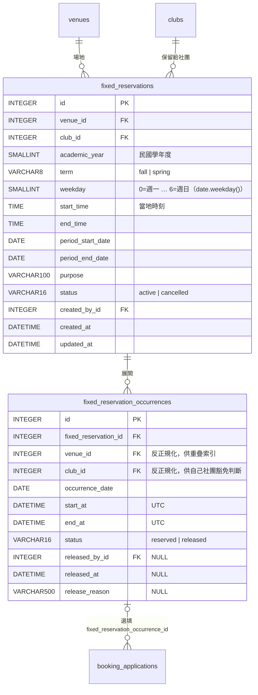

# ADR-006 學期區間與固定保留時段的資料模型預留

- 狀態：Proposed（待 T-001 設計審查通過後改為 Accepted）
- 日期：2026-11-06（第 2 版：`semester.py` 改由 T-014 負責；Sprint 1 只實作 `is_in_semester`）
- 相關：US-004 AC17（**Sprint 1 實作**）；US-009（固定保留時段）、US-018（寒暑假時段）、US-020（未告知放棄計次）、US-019（停權）——僅設計；T-014、T-016、T-019

## 背景

使用者決定（2026-11-06）：

1. 學期區間暫定每年 **9/1～12/31（上學期）**、**3/1～6/30（下學期）**，其餘日期為寒暑假；US-018 假設「學期區間以月日固定判斷，不需承辦人每年設定」。
2. **Sprint 1 即拒絕學期區間以外的日期**（US-004 AC17）；US-018 完成後，寒暑假改依開放時段設定判斷。
3. 固定借用每次仍需社團送出申請；固定保留時段（US-009）不在 Sprint 1，但 ERD 需預留不必大改的模型。

學期資訊未來被三處使用：US-009（保留期間須在同一學期內）、US-018（學期外才套用寒暑假規則）、US-020（R-22 依「活動日期所屬學期」累計次數、停權迄日為學期最後一天）。

## 選項：學期區間的設定方式

| 選項 | 評估 |
|---|---|
| A. **程式內單一來源常數 + 純函式** | 規則是「業務規則」而非「環境設定」，各環境必須一致；純函式可完整單元測試、不依賴 DB；符合 US-018「不需每年設定」；與 T-014 工作天作法一致 |
| B. `.env` 設定月日（例如 `SEMESTER_FALL=09-01:12-31`） | 需自訂解析與驗證；不同環境可能設定不一致導致測試與正式結果不同；業務規則散落在部署設定 |
| C. `semesters` 資料表 + 承辦人維護介面 | 最有彈性（可依校曆每年調整），但 Sprint 1 沒有介面；判斷需查 DB，失去純函式特性；目前無此需求 |

## 決策

### 1. 學期區間：選項 A（檔案 `app/services/semester.py`，**T-014 負責**，純函式，波次 2 即可完成）

**Sprint 1 只實作 `Term`、`TermRule`、`TERM_RULES`、`is_in_semester`**（Code Review #15）。`Semester` 與 `semester_of` 為已定案的**設計**，於第一個需要學期識別的 Story（US-009 / US-020）實作；`is_in_semester` 的實作只需檢查 `day` 的月日是否落在任一規則內。

```python
import datetime as dt

class Term(StrEnum):
    FALL = 'fall'          # 上學期
    SPRING = 'spring'      # 下學期

@dataclass(frozen=True, slots=True)
class TermRule:
    term: Term
    start_month: int
    start_day: int
    end_month: int
    end_day: int
    academic_year_offset: int    # 民國學年度 = 西元年 - 1911 + offset

TERM_RULES: Final[tuple[TermRule, ...]] = (
    TermRule(Term.FALL, 9, 1, 12, 31, academic_year_offset=0),     # 2026-09-01 → 115 學年度上學期
    TermRule(Term.SPRING, 3, 1, 6, 30, academic_year_offset=-1),   # 2027-03-01 → 115 學年度下學期
)

def is_in_semester(day: dt.date, rules: Sequence[TermRule] = TERM_RULES) -> bool:
    """day（APP_TIMEZONE 當地日期）是否落在任一學期區間（含兩端）。US-004 AC17 使用。Sprint 1 實作。"""

# ---- 以下為設計，Sprint 1 不實作（US-009 / US-020 時加入，is_in_semester 屆時改為 semester_of(day) is not None）----
@dataclass(frozen=True, slots=True)
class Semester:
    academic_year: int     # 民國學年度，例如 115
    term: Term
    start_date: dt.date
    end_date: dt.date      # 含當日

    @property
    def label(self) -> str:
        """例如「115 學年度上學期」。"""

def semester_of(day: dt.date, rules: Sequence[TermRule] = TERM_RULES) -> Semester | None:
    """回傳 day 所屬學期；不在任何學期區間（寒暑假）時回傳 None。"""
```

- 純函式：不匯入 DB、設定、`Clock`；`rules` 參數讓測試與未來改為資料表時可注入（屆時由 service 讀表後傳入，函式本身仍為純函式）。
- 每條規則必須落在同一西元年內（起月日 ≤ 迄月日），規則之間不得重疊——以單元測試對 `TERM_RULES` 斷言。
- 測試（T-014，`pytest.mark.parametrize`）：
  - `is_in_semester` 為 True：2026-09-01、2026-12-31、2027-03-01、2027-06-30（AC17 邊界）、2026-11-16。
  - `is_in_semester` 為 False：2026-08-31、2027-01-01、2027-01-04（AC17）、2027-02-28、2028-02-29（閏年）、2027-07-01。
  - `TERM_RULES` 每條規則起月日 ≤ 迄月日、規則間不重疊。
  - T-019 另以服務層測試驗證 AC17 錯誤訊息（四個邊界與前後一天）。
  - （未來 `semester_of` 測試：2026-09-01 → `Semester(115, FALL, 2026-09-01, 2026-12-31)`；2027-06-30 → `Semester(115, SPRING, 2027-03-01, 2027-06-30)`。）

#### Sprint 1 使用點

| 使用者 | 用法 |
|---|---|
| T-019 `BookingService.apply` | 不開放日檢查之後：`if not is_in_semester(payload.date): raise BusinessRuleError('outside_semester', '該日期不在學期期間，暫不開放借用')` |
| T-016 `AvailabilityService.get_week` | `DayAvailability.in_semester = is_in_semester(day)`，並據以決定 `DayAvailability.status`（不開放優先於學期外；routes.md 2.3 優先規則）；學期外日期整天標示「不開放（非學期期間）」（US-002 AC6，已由 PO 定案） |

### 2. 寒暑假時段（US-018，僅設計）

- 資料表 `vacation_opening_rules`（erd.md 第 4 節）。
- 屆時新增 service 函式取代 Sprint 1 的「學期區間」步驟：

  ```python
  def opening_hours_for(day: dt.date, vacation_rules: Sequence[VacationRule]) -> tuple[dt.time, dt.time] | None:
      """學期內 → (OPEN_TIME, CLOSE_TIME)（R-01）；學期外 → 涵蓋該日的寒暑假規則時段；都沒有 → None（不開放）。"""
  ```

- `BookingService` 的 R-01 檢查與學期檢查合併為「依 `opening_hours_for` 檢查時段」，錯誤碼 `outside_semester` 改為 `vacation_closed`（「寒暑假期間未開放借用」）或 `outside_opening_hours`（「該日開放時段為 09:00–17:00」）。不開放期間（US-017）仍優先（US-018 AC4）。
- US-018 AC6「期間不得含學期區間內日期」以 `semester_of` 檢查期間內每一天（或起訖兩端與跨越判斷）。

### 3. 固定保留時段（US-009，僅設計）

採「**系列 + 逐日場次**」兩張表：系列記錄協調會決議，場次為每個實際日期的具體 UTC 區間（US-009 AC1 要求「為每個日期建立一筆」、AC2 略過不開放日、AC11 個別釋出某一天）。



- `fixed_reservations` CHECK：`term IN ('fall','spring')`、`weekday BETWEEN 0 AND 6`、`end_time > start_time`、`period_end_date >= period_start_date`、`status IN ('active','cancelled')`。期間須在同一學期內：`semester_of(period_start_date) == semester_of(period_end_date) is not None`（service 檢查，US-009 AC4）；`academic_year`、`term` 由該結果寫入。
- `fixed_reservation_occurrences`：UQ `(fixed_reservation_id, occurrence_date)`；IX `(venue_id, start_at, end_at, status)`（與 `booking_applications` 相同形狀，重疊查詢可共用寫法）；CHECK `end_at > start_at`、`status IN ('reserved','released')`。
- `booking_applications` 新增 `fixed_reservation_occurrence_id INTEGER NULL FK → fixed_reservation_occurrences.id ON DELETE RESTRICT`（加 nullable 欄位，batch migration 即可）。社團依自己的保留場次送出申請時由 service 填入。
- **重疊檢查如何納入**（詳見 ADR-003 第 5 節）：
  - 社團申請：衝突 = 任何社團的佔用申請重疊 ∪ 狀態 `reserved` 且 `club_id ≠ 申請社團` 的保留場次重疊；同一 `BEGIN IMMEDIATE` 交易。
  - 承辦人登錄保留：衝突 = 其他社團的佔用申請重疊 ∪ 任何 `reserved` 保留場次重疊 → 整批不建立（US-009 AC3）。
  - 申請被駁回或取消後，保留場次仍為 `reserved`（US-009 假設），只有承辦人釋出才改 `released`。
- 週檢視（US-009 AC5）：保留場次若該社團尚無覆蓋該場次的佔用申請，顯示「固定保留（社團名稱）」；有則顯示該申請狀態。
- R-13：保留登錄不受限（US-009 AC8）；社團對保留場次的每次申請仍受 R-13（`workday.can_apply`）。

### 4. 未告知放棄計次（US-020）與停權（US-019），僅設計

- `no_show_records.academic_year`、`term` 由 `semester_of(活動當地日期)` 計算後**寫入**（不在查詢時重算），日後學期規則變更不影響歷史計次。
- 自動停權迄日 = `semester_of(活動日).end_date`。
- 活動日在學期外（`semester_of` 回傳 `None`）如何計次，屬 US-020 待釐清事項；本設計以 `None` 明確表達「不屬任何學期」，由 PO 決定後再補規則。Sprint 1 拒絕學期外申請，因此暫不會產生此類資料（US-018 完成後才會出現）。

### 5. 若日後學校要求「依校曆每年設定學期日期」

改為選項 C：新增 `semesters` 資料表（`academic_year`, `term`, `start_date`, `end_date`，UQ `(academic_year, term)`）與維護介面；`semester_of(day, rules)` 改為接收由資料表載入的學期清單。`fixed_reservations` / `no_show_records` 已使用 `(academic_year, term)` 表示學期，可直接對應，不需改表。

## 影響

- 正面：Sprint 1 只需新增一個無相依的純函式模組即可滿足 AC17；US-009 / US-018 / US-020 只需「加表、加 nullable 欄位」，不需修改既有欄位語意。
- 負面：學期日期改變需修改程式並部署（目前使用者已確認以固定月日判斷，可接受）。
- 已解決：週檢視標示學期外日期——PO 已寫入 US-002 AC6～AC8（第 3 版）。
- 待確認：申請可提前多久（US-004 待釐清）：本設計不設上限；學期判斷本身不限制年份。
- 不需新增套件。
