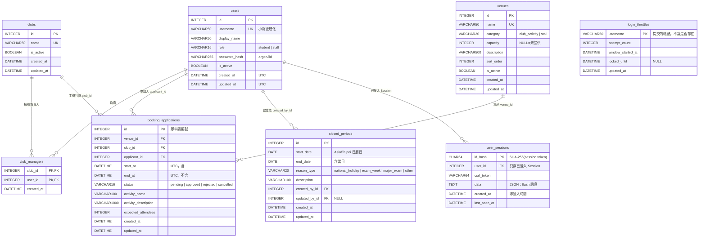
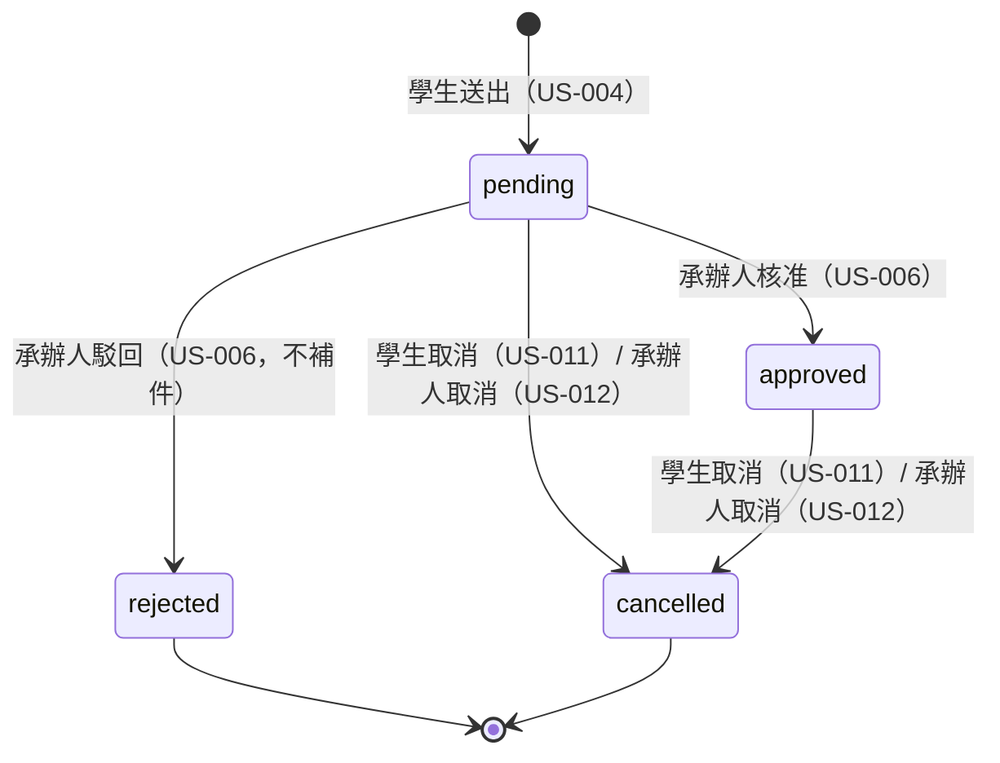

# 資料模型 ERD（Sprint 1）

- 對應 Task：T-001（設計）、T-005（model 與 migration 實作）、T-006（場地初始資料）
- 依據：AGENTS.md 1.3、ADR-001（Session）、ADR-003（重疊）、ADR-004（時間）、ADR-005（鎖定）、ADR-006（學期與固定保留預留）
- 最後更新：2026-11-06

## 1. 總覽

## 2. 共通規則（T-005 實作）

| 項目 | 規則 |
|---|---|
| Base | `app/models/base.py`：`class Base(DeclarativeBase)`，`metadata = MetaData(naming_convention=NAMING_CONVENTION)` |
| Naming convention | `{'ix': 'ix_%(column_0_label)s', 'uq': 'uq_%(table_name)s_%(column_0_name)s', 'ck': 'ck_%(table_name)s_%(constraint_name)s', 'fk': 'fk_%(table_name)s_%(column_0_name)s_%(referred_table_name)s', 'pk': 'pk_%(table_name)s'}`；CHECK 一律給 `name=`（下表「CHECK 名稱」欄） |
| 主鍵 | `id: Mapped[int] = mapped_column(primary_key=True)`（SQLite `INTEGER PRIMARY KEY`＝rowid）；不使用 `AUTOINCREMENT`（不需要防 id 重用，且申請編號不會刪除） |
| 時間欄位 | `UTCDateTime`（ADR-004，**定義於 `app/models/base.py`，由 T-005 建立**）：寫入時必須是 timezone-aware，轉 UTC 後存成 `YYYY-MM-DD HH:MM:SS.ffffff`；讀出時附上 `UTC` tzinfo。naive datetime 寫入即拋 `ValueError` |
| Migration 中的型別 | migration 檔**不得匯入 `app.models`**（避免 model 日後變更使舊 migration 失效）；`UTCDateTime` 欄位在 migration 一律寫 `sa.DateTime()`（儲存格式相同）。`migrations/env.py` 設定 `render_item`，autogenerate 遇到 `UTCDateTime` 時輸出 `sa.DateTime()`，並設定 `compare_type` 時把兩者視為相同，使 `alembic check` 無差異 |
| 日期欄位 | `sa.Date`，代表 `APP_TIMEZONE` 的日曆日（不是時間點） |
| `created_at`/`updated_at` | `TimestampMixin`；由 ORM `default=`/`onupdate=` 以 `datetime.now(UTC)` 產生（**不用** `server_default=func.now()`，SQLite 的 `CURRENT_TIMESTAMP` 格式與 `UTCDateTime` 不同） |
| 布林 | `sa.Boolean(create_constraint=True, name=...)`，`server_default=sa.true()` / `sa.false()` |
| 列舉 | `sa.String(n)` + 具名 CHECK 白名單（不用 `sa.Enum` native，避免 SQLite batch 遷移時 constraint 名稱不穩定）；Python 端以 `StrEnum` 對應 |
| 字串長度 | SQLite 不強制 `VARCHAR(n)`；**需要長度保證的欄位加 CHECK `length(col) BETWEEN a AND b`**；Pydantic schema 仍是第一道驗證 |
| 外鍵 | 交易性資料（申請、不開放期間）`ON DELETE RESTRICT`；關聯表與 Session `ON DELETE CASCADE`。業務上以 `is_active=false` 停用，不刪除使用者、社團、場地 |
| PRAGMA | `foreign_keys=ON`、`journal_mode=WAL`、`busy_timeout`（T-004） |

## 3. 資料表規格

符號：PK 主鍵、FK 外鍵、UQ 唯一、NN NOT NULL、IX 索引。

### 3.1 `users`（US-013、T-008、T-009）

| 欄位 | SQLAlchemy 型別 | NN | 預設 | 說明 |
|---|---|---|---|---|
| `id` | `Integer` | ✔ | | PK |
| `username` | `String(50)` | ✔ | | UQ `uq_users_username`。只儲存 `normalize_username()`（`app/core/security.py`，ADR-005 2.1）的結果：去空白、小寫、`[a-z0-9._-]{1,50}` |
| `display_name` | `String(50)` | ✔ | | 姓名（個資，不寫入日誌） |
| `role` | `String(16)` | ✔ | | `student` / `staff` |
| `password_hash` | `String(255)` | ✔ | | argon2id PHC 字串；**禁止**任何明碼或可逆欄位 |
| `is_active` | `Boolean` | ✔ | `true` | 停用 → 不能登入，既有 Session 失效（ADR-001） |
| `created_at` / `updated_at` | `UTCDateTime` | ✔ | ORM | |

| CHECK 名稱 | 條件 |
|---|---|
| `role` | `role IN ('student','staff')` |
| `username_format` | `length(username) BETWEEN 1 AND 50 AND username = lower(username)` |
| `display_name_length` | `length(display_name) BETWEEN 1 AND 50` |

> `email`（US-014）、`must_change_password`（US-015）不在 Sprint 1 建立，見第 4 節預留。

### 3.2 `clubs`（US-004、T-009）

| 欄位 | 型別 | NN | 預設 | 說明 |
|---|---|---|---|---|
| `id` | `Integer` | ✔ | | PK |
| `name` | `String(50)` | ✔ | | UQ `uq_clubs_name`；儲存前 `strip()` |
| `is_active` | `Boolean` | ✔ | `true` | Sprint 1 申請時要求社團啟用中（停權另見 US-019 預留表） |
| `created_at` / `updated_at` | `UTCDateTime` | ✔ | ORM | |

CHECK `name_length`：`length(name) BETWEEN 1 AND 50`。

> 社團代碼 `code`（US-014 AC1）不在 Sprint 1 建立，見第 4 節預留。

### 3.3 `club_managers`（社團負責人關聯，多對多）

| 欄位 | 型別 | NN | 說明 |
|---|---|---|---|
| `club_id` | `Integer` | ✔ | FK → `clubs.id` `ON DELETE CASCADE`；PK 之一 |
| `user_id` | `Integer` | ✔ | FK → `users.id` `ON DELETE CASCADE`；PK 之一 |
| `created_at` | `UTCDateTime` | ✔ | |

- PK `pk_club_managers (club_id, user_id)`；IX `ix_club_managers_user_id (user_id)`（查「我負責的社團」）。
- 「負責人必須是 `student` 角色」無法以 CHECK 跨表檢查，由 `account_service` 驗證（T-009）。
- 一個社團可多位負責人、一位學生可負責多個社團（US-014 AC4）。

### 3.4 `venues`（US-001、T-006、T-011）

| 欄位 | 型別 | NN | 預設 | 說明 |
|---|---|---|---|---|
| `id` | `Integer` | ✔ | | PK |
| `name` | `String(50)` | ✔ | | UQ `uq_venues_name` |
| `category` | `String(20)` | ✔ | | `club_activity`（社團活動場地）/ `stall`（擺攤場地） |
| `capacity` | `Integer` | | NULL | NULL 顯示「未提供」；有值時申請人數不得超過（US-004 AC15） |
| `description` | `String(500)` | ✔ | `''` | 純文字，autoescape 輸出 |
| `sort_order` | `Integer` | ✔ | `0` | 同類別內的顯示順序（中文名稱以 code point 排序不直覺）；排序為 `category, sort_order, name` |
| `is_active` | `Boolean` | ✔ | `true` | 停用場地不顯示、不能申請 |
| `created_at` / `updated_at` | `UTCDateTime` | ✔ | ORM | |

| CHECK 名稱 | 條件 |
|---|---|
| `category` | `category IN ('club_activity','stall')` |
| `capacity_range` | `capacity IS NULL OR capacity BETWEEN 1 AND 99999` |
| `name_length` | `length(name) BETWEEN 1 AND 50` |

IX `ix_venues_is_active (is_active, category, sort_order)`（資料量小，主要為語意清楚；可省略）。

T-006 初始資料（`sort_order` 依此順序 10、20、…）：學生活動中心、驚聲廣場、同舟廣場、覺軒花園教室、五虎崗舞蹈教室、體育館 1 樓、B1 社辦廣場（`club_activity`）；海報街（`stall`）。同舟廣場貴賓室不建立。

### 3.5 `closed_periods`（US-017、T-013）

| 欄位 | 型別 | NN | 說明 |
|---|---|---|---|
| `id` | `Integer` | ✔ | PK |
| `start_date` | `Date` | ✔ | 起日（含），`APP_TIMEZONE` 日曆日 |
| `end_date` | `Date` | ✔ | 迄日（含）；可與起日同一天 |
| `reason_type` | `String(20)` | ✔ | `national_holiday`（國定假日）/ `exam_week`（考試週）/ `major_exam`（大型考試）/ `other`（其他） |
| `description` | `String(100)` | ✔ | 1～100 字 |
| `created_by_id` | `Integer` | ✔ | FK → `users.id` `ON DELETE RESTRICT` |
| `updated_by_id` | `Integer` | | FK → `users.id` `ON DELETE RESTRICT`；未編輯過為 NULL |
| `created_at` / `updated_at` | `UTCDateTime` | ✔ | |

| CHECK 名稱 | 條件 |
|---|---|
| `reason_type` | `reason_type IN ('national_holiday','exam_week','major_exam','other')` |
| `date_order` | `end_date >= start_date` |
| `max_span` | `julianday(end_date) - julianday(start_date) <= 365`（含頭尾最多 366 天，US-017 AC5） |
| `description_length` | `length(description) BETWEEN 1 AND 100` |

- IX `ix_closed_periods_start_date (start_date, end_date)`。查詢「與區間 [a, b] 有交集的期間」：`start_date <= :b AND end_date >= :a`。
- 允許期間彼此重疊（例如考試週內含國定假日）；查某日時回傳**所有**涵蓋該日的期間，顯示去重後的原因類型。
- **不參與 R-13 工作天計算**（使用者決定）。

### 3.6 `booking_applications`（US-004、US-002、T-016、T-018、T-019）

| 欄位 | 型別 | NN | 預設 | 說明 |
|---|---|---|---|---|
| `id` | `Integer` | ✔ | | PK，畫面上的「申請編號」 |
| `venue_id` | `Integer` | ✔ | | FK → `venues.id` `ON DELETE RESTRICT` |
| `club_id` | `Integer` | ✔ | | FK → `clubs.id` `ON DELETE RESTRICT` |
| `applicant_id` | `Integer` | ✔ | | FK → `users.id` `ON DELETE RESTRICT`；**不得**出現在公開查詢結果 |
| `start_at` | `UTCDateTime` | ✔ | | 區間起點（含） |
| `end_at` | `UTCDateTime` | ✔ | | 區間終點（不含），半開區間 `[start_at, end_at)` |
| `status` | `String(16)` | ✔ | `'pending'` | `pending`（審核中）/ `approved`（已核准）/ `rejected`（已駁回）/ `cancelled`（已取消）。**無**退回補件 |
| `activity_name` | `String(100)` | ✔ | | 公開欄位 |
| `activity_description` | `String(1000)` | ✔ | | 非公開；不寫入日誌 |
| `expected_attendees` | `Integer` | ✔ | | 1～9999 |
| `created_at` / `updated_at` | `UTCDateTime` | ✔ | ORM | |

| CHECK 名稱 | 條件 |
|---|---|
| `status` | `status IN ('pending','approved','rejected','cancelled')` |
| `time_order` | `end_at > start_at`（`UTCDateTime` 固定格式，字串比較即時間比較） |
| `activity_name_length` | `length(activity_name) BETWEEN 1 AND 100` |
| `activity_description_length` | `length(activity_description) BETWEEN 1 AND 1000` |
| `expected_attendees_range` | `expected_attendees BETWEEN 1 AND 9999` |

| Index | 欄位 | 用途 |
|---|---|---|
| `ix_booking_applications_venue_id` | `(venue_id, start_at, end_at, status)` | 重疊檢查（T-018）、週檢視（T-016）；涵蓋索引 |
| `ix_booking_applications_status` | `(status, start_at)` | 不開放期間受影響申請（跨場地，T-013）、未來待審清單（US-006） |
| `ix_booking_applications_club_id` | `(club_id)` | 未來社團查詢、停權受影響申請 |
| `ix_booking_applications_applicant_id` | `(applicant_id)` | 未來「我的申請」（US-005） |

- **重疊無法以 constraint 防止**，由 T-018 在 `BEGIN IMMEDIATE` 交易內檢查（ADR-003）。
- 「單筆申請限同一天、08:00–22:00、30 分鐘倍數」屬商業規則，於 schema / service 檢查，不寫成 CHECK（R-01 未來會被寒暑假時段改變，ADR-006）。
- 狀態轉換（Sprint 1 只會產生 `pending`）：

佔用狀態 `OCCUPYING_STATUSES = {pending, approved}`。

### 3.7 `user_sessions`（ADR-001、T-007）

| 欄位 | 型別 | NN | 說明 |
|---|---|---|---|
| `id_hash` | `String(64)` | ✔ | PK。`hashlib.sha256(token.encode()).hexdigest()`；Cookie 存原始 token，DB 只存雜湊（DB 外洩不等於 Session 外洩） |
| `user_id` | `Integer` | ✔ | FK → `users.id` `ON DELETE CASCADE`。**只儲存已登入的 Session**；登入前的 CSRF 以無狀態 HMAC Token 處理，不寫 DB（ADR-002，防止匿名請求灌爆資料表） |
| `csrf_token` | `String(64)` | ✔ | `secrets.token_urlsafe(32)`（43 字元）；ADR-002 |
| `data` | `Text` | ✔ | JSON 物件字串，預設 `'{}'`；Sprint 1 只放 flash 訊息（`{"flashes": [{"level": "success", "text": "..."}]}`）。**禁止**放密碼、個資或授權資訊；序列化只用 `json`（禁止 `pickle`） |
| `created_at` | `UTCDateTime` | ✔ | 登入時間，絕對逾時起算點 |
| `last_seen_at` | `UTCDateTime` | ✔ | 閒置逾時起算點；最多每 60 秒更新一次 |

- IX `ix_user_sessions_user_id (user_id)`（停用帳號/重設密碼時刪除該使用者所有 Session，US-014 AC5、AC6）；IX `ix_user_sessions_last_seen_at (last_seen_at)`（清理）。
- CHECK `data_length`：`length(data) <= 4096`。

### 3.8 `login_throttles`（ADR-005、T-008）

| 欄位 | 型別 | NN | 說明 |
|---|---|---|---|
| `username` | `String(50)` | ✔ | PK。使用者提交後 `normalize_username()` 的結果（格式不合者不記錄），**不論帳號是否存在**都記錄（防帳號列舉） |
| `attempt_count` | `Integer` | ✔ | 目前時間窗內**尚未成功**的登入嘗試數（驗證密碼**前**即先加 1，成功登入時刪除整列，ADR-005）；CHECK `attempt_count >= 0` |
| `window_started_at` | `UTCDateTime` | ✔ | 本時間窗第一次嘗試時間 |
| `locked_until` | `UTCDateTime` | | 鎖定到期時間；NULL＝未鎖定 |
| `updated_at` | `UTCDateTime` | ✔ | 清理用 |

- 刻意**不**對 `users` 設外鍵（要能記錄不存在的帳號）。
- IX `ix_login_throttles_updated_at (updated_at)`。

## 4. 未來 Story 的資料模型預留（Sprint 1 **不建立**）

以下由對應 Story 的 migration 新增；Sprint 1 的設計已確保不需修改既有欄位語意，只需「加表 / 加 nullable 欄位」（Alembic `render_as_batch=True`）。

| Story | 預留 | 對既有表的影響 |
|---|---|---|
| US-009 固定保留時段 | `fixed_reservations`、`fixed_reservation_occurrences`（見 ADR-006） | `booking_applications.fixed_reservation_occurrence_id INTEGER NULL FK`（選填，社團依保留時段送出的申請） |
| US-018 寒暑假時段 | `vacation_opening_rules`（`id`, `name String(50)`, `start_date Date`, `end_date Date`, `open_time Time`, `close_time Time`, `created_by_id`, 時間戳；CHECK `end_date >= start_date`、`close_time > open_time`） | 無 |
| US-006 審核 | `booking_status_history`（`booking_id`, `from_status`, `to_status`, `actor_id`, `reason String(500)`, `created_at`） | `booking_applications` 加 `reviewed_by_id`、`reviewed_at`、`review_note`（nullable） |
| US-011 / US-012 取消 | | `booking_applications` 加 `cancelled_by_id`、`cancelled_at`、`cancel_reason_type`、`cancel_reason`、`is_late_cancellation`（nullable / 預設 false） |
| US-019 停權 | `club_suspensions`（`club_id`, `start_date`, `end_date`, `reason String(500)`, `created_by_id`, `source`（`manual` / `r22_auto`）, 時間戳） | 無 |
| US-020 未告知放棄 | `no_show_records`（`booking_id UQ FK`, `club_id`, `academic_year SmallInteger`, `term String(8)`, `note`, `recorded_by_id`, `recorded_at`, `revoked_at NULL`, `revoked_by_id NULL`, `revoke_reason NULL`） | 無；`academic_year`/`term` 由 `semester_of(活動日)` 計算後寫入（ADR-006） |
| US-007 附件 | `booking_attachments`（另需檔案上傳 ADR） | 無 |
| US-010 貴賓室加借 | `booking_applications` 加 `vip_room_requested Boolean`、`vip_room_purpose String(200) NULL` | 無 |
| US-014 社團與學生維護 | | `users` 加 `email String(254) NULL`；`clubs` 加 `code String(20) NULL` + UQ `uq_clubs_code`（SQLite UNIQUE 允許多個 NULL） |
| US-015 變更密碼 | | `users` 加 `must_change_password Boolean NOT NULL server_default false` |

## 5. 修訂紀錄

| 日期 | 修訂 | 依據 |
|---|---|---|
| 2026-11-06 | 初版 | T-001 |
| 2026-11-06 | 第 3 版：修正 §3.1 / §3.2 表格被引言截斷；帳號一律經 `normalize_username()` | T-001 Code Review n-2、Security Review NB-5 |
| 2026-11-06 | 第 2 版：移除 `users.email`、`users.must_change_password`、`clubs.code`（改列預留）；`user_sessions.user_id` 改 NOT NULL、移除 `authenticated_at`（不再有匿名 Session）；`login_throttles.failure_count` 改名 `attempt_count`（先記錄嘗試再驗證）；新增 migration 型別規則 | T-001 Code Review #13、#15；Security Review B-1、N-1 |
