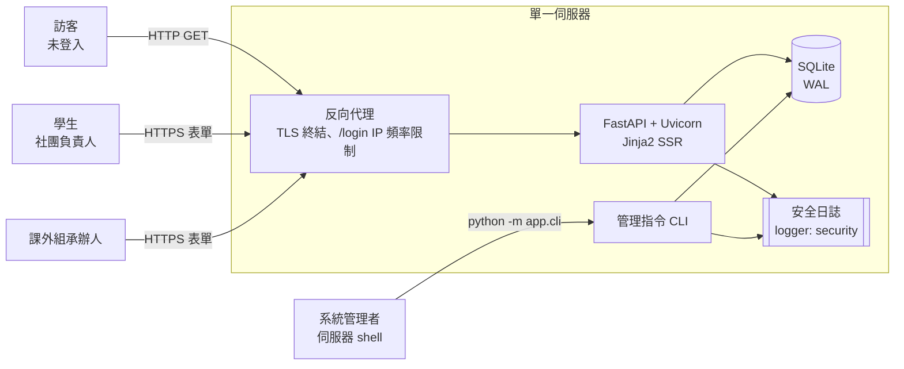
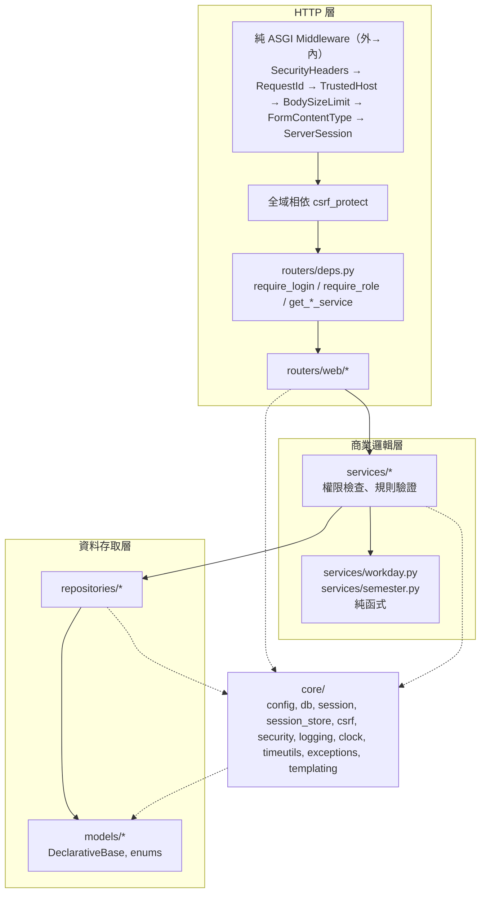
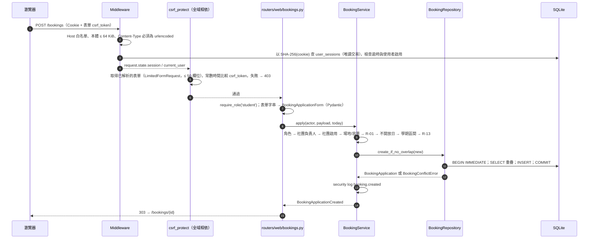
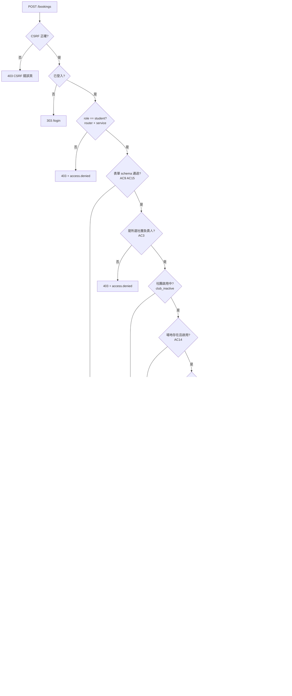

# 系統架構總覽（Sprint 1）

- 文件負責：System Analyst(系統分析師)
- 對應 Task：T-001；適用 Sprint 1 選入的 Story：US-013、US-001、US-017、US-002、US-004
- 最後更新：2026-11-07（第 4 版：`APP_DEBUG` 用途、`DATABASE_URL` / Session 秒數 / `SESSION_COOKIE_NAME` 驗證（第 4 節）；context processor 保留名稱與 flash 分工、`day_status_label` 由 T-017 註冊（第 3、5 節））
- 前一版：2026-11-06（第 3 版：依第 2 輪 Code Review / Security Review 修訂）

相關文件：

| 文件 | 內容 |
|---|---|
| [erd.md](erd.md) | 資料模型 ERD(實體關聯圖)、欄位、constraint(約束)、index(索引)、未來預留 |
| [routes.md](routes.md) | web route 清單、表單欄位、樣板變數約定 |
| [error-handling.md](error-handling.md) | 例外類別、HTTP 狀態碼、錯誤頁 |
| [security-logging.md](security-logging.md) | 安全日誌事件與欄位、禁止記錄的欄位、告警規則 |
| [cli.md](cli.md) | 管理指令 CLI 規格 |
| [adr/](adr/) | ADR-001～ADR-006 架構決策紀錄 |

---

## 1. 系統脈絡



- 全部頁面為 Jinja2 SSR(伺服器端渲染) + HTML 表單；**Sprint 1 不提供 JSON API**（不建立 `app/routers/api/`）。理由：所有 Story 都是瀏覽器操作，沒有外部系統整合需求；少一組端點即少一組認證、CSRF 與 CORS 攻擊面。
- 不依賴前端 JavaScript 即可完成所有流程（CSP 禁止 inline script，見第 8 節）。
- FastAPI 建立時關閉自動文件：`FastAPI(docs_url=None, redoc_url=None, openapi_url=None)`；T-003 以測試驗證 `/docs`、`/redoc`、`/openapi.json` 皆回 404。

## 2. 分層架構



Middleware 順序理由：`SecurityHeaders` 最外層，確保 TrustedHost（400）、BodySizeLimit（413）等提早回應也帶安全標頭；`RequestId` 次之，讓後續所有日誌都有 `request_id`；`TrustedHost`、`BodySizeLimit`、`FormContentType`（非 urlencoded 的 POST → 415，ADR-002 2.1）在讀取 Session（DB）之前擋掉不合法請求，這些 middleware 層的錯誤回應為純文字（error-handling.md 3.2）。`ServerSession` 對 `/static/*`、`/healthz` 不查 DB。Starlette `add_middleware` 後加者在外層，`create_app` 需以相反順序加入。所有 router 使用 `LimitedFormRoute`（表單欄位上限）。

| 層 | 可以做 | 不可以做 |
|---|---|---|
| `routers/web` | 解析表單/路徑/查詢參數為字串、組 Pydantic schema、呼叫 service、把 domain 例外轉成 HTTP 回應或重新渲染表單、操作 HTTP Session（建立、銷毀、flash） | 直接使用 SQLAlchemy `Session`、寫商業規則 |
| `services` | 權限檢查（**每個操作都要**，預設拒絕）、商業規則、呼叫 repository、決定交易邊界、記錄安全日誌 | 讀寫 `Request`/`Response`、回傳 HTTP 狀態碼、渲染樣板 |
| `repositories` | ORM 查詢與寫入、`immediate_transaction` 內的衝突檢查 | 權限判斷、商業規則（重疊判斷屬資料一致性，例外地放在 repository，見 ADR-003） |
| `models` | SQLAlchemy model、列舉（`app/models/enums.py`） | 匯入 `app.models` 以外的 app 模組 |
| `core` | 基礎設施：設定、DB engine、交易工具、HTTP Session 儲存、CSRF、密碼雜湊、日誌、時鐘、例外類別、Jinja2 環境 | 匯入 `services`、`repositories`、`routers`、`schemas` |

**匯入規則**（ruff 無法自動檢查，Code Review 檢查項）：

- `models` → 只匯入 `app.models.*`。
- `core` → 可匯入 `models`（僅 `session_store`、`identity` 需要），不可匯入其他上層。
- `repositories` → `core`、`models`。
- `services` → `repositories`、`core`、`models`、`schemas`、純函式模組。
- `routers` → `services`、`schemas`、`core`、`routers/deps.py`；**不可**匯入 `repositories`。
- `services/workday.py`、`services/semester.py` 為純函式模組，只能匯入標準函式庫。

**HTTP Session 儲存的定位（Code Review #4）**：`user_sessions` 的存取屬「HTTP Session 基礎設施」而非商業資料，因此放在 `app/core/session_store.py`（直接以 ORM 存取 `UserSession` model），**不**放在 `repositories/`。如此 `core/session.py`（middleware）不需反向依賴 `repositories`，分層原則沒有例外。

### 2.1 依賴注入慣例

- Service 與 repository 皆為「每個請求建立一次」的類別，建構子接收 SQLAlchemy `Session`：

  ```python
  class BookingService:
      def __init__(self, session: Session, settings: Settings) -> None: ...
  ```

- `app/routers/deps.py` 提供 `get_booking_service(session: Session = Depends(get_session), settings: Settings = Depends(get_settings)) -> BookingService` 等工廠函式；router 只 `Depends(get_xxx_service)`，不直接拿到 `Session`。
- 「現在時間」一律由 `app/core/clock.py` 的 `Clock` 提供，route 以 `Depends(get_clock)` 取得後把 `today`／`now` 傳給 service；測試以 `app.dependency_overrides[get_clock]` 固定日期（R-13、AC11～AC13、AC17 測試需要）。

  ```python
  class Clock(Protocol):
      def now_utc(self) -> dt.datetime: ...          # timezone-aware UTC
      def today_local(self) -> dt.date: ...          # APP_TIMEZONE 的日期
  class SystemClock:  # 預設實作
      def __init__(self, tz: ZoneInfo) -> None: ...
  class FixedClock:   # 測試用，放 tests/fixtures/
      def __init__(self, now_utc: dt.datetime, tz: ZoneInfo) -> None: ...
  def get_clock(settings: Settings = Depends(get_settings)) -> Clock: ...
  ```

- **`datetime` 匯入慣例（Code Review #14、n-1）**：**`app/` 下所有模組**（models、schemas、repositories、services、routers、core、cli）與 `tests/` 一律 `import datetime as dt`，型別寫 `dt.date`、`dt.time`、`dt.datetime`、`dt.UTC`，不使用 `from datetime import ...`，避免欄位名 `date` 與型別 `date` 同名造成 Pydantic / mypy 混淆（ADR-004 §3 同一規則）。

### 2.2 請求處理流程（以學生送出申請為例）



## 3. 目錄與模組清單（對應負責 Task）

> 檔名為規格，開發者應依此建立；如需改名請回報 SA 更新本文件，避免平行 Task 衝突。共用型別的**負責 Task** 是「第一個建立它的 Task」，後續 Task 只能新增、不可改既有簽章（需改時回報 Orchestrator）。

### 3.1 共用型別與模組的擁有者（Code Review #3）

| 型別 / 模組 | 定義位置 | 負責 Task | 使用者 |
|---|---|---|---|
| `Settings`、`get_settings` | `app/core/config.py` | T-003 | 全部 |
| `security_log`、`SecurityEvent`、`configure_logging`、`bind_request_context` / `reset_request_context`（`RequestContextTokens`）、`bind_cli_context` | `app/core/logging.py` | T-003 | T-007～T-019；`bind_request_context` / `reset_request_context` 由 T-023 `RequestIdMiddleware` 呼叫；`configure_logging` → `bind_cli_context` 由 T-009 CLI 進入點依序呼叫（security-logging.md 第 1 節） |
| 全部例外（含 `LoginRequired`、`CSRFError`） | `app/core/exceptions.py` | T-003 | 全部 |
| `Clock`、`SystemClock`、`get_clock` | `app/core/clock.py` | T-003 | T-007、T-008、T-016、T-019、T-020 |
| `local_to_utc`、`utc_to_local`、`local_day_bounds_utc` | `app/core/timeutils.py` | **T-003** | T-013、T-016、T-019 |
| `apply_security_headers`、`SecurityHeadersMiddleware`、`RequestIdMiddleware`、TrustedHost 設定、`BodySizeLimitMiddleware`、`FormContentTypeMiddleware`、`BodyTooLargeAfterResponseStart` | `app/core/middleware.py` | **T-023** | – |
| `LimitedFormRequest`、`LimitedFormRoute`、`FORM_MAX_FIELDS`、**`SAFE_METHODS`** | `app/core/forms.py` | **T-023** | 所有 router；`SAFE_METHODS` 由 `FormContentTypeMiddleware` 與 T-007 `csrf_protect` 共用 |
| **`ALL_ROUTERS`**（全部 web router 的唯一清單；`create_app` 只從此清單 `include_router`） | `app/routers/__init__.py` | **T-023**（建立空清單與掛載迴圈；T-010、T-012、T-015、T-017、T-020 加入各自 router） | `app/main.py`、覆蓋測試 |
| route 覆蓋測試 helper `iter_api_routes` 與 `tests/integration/test_route_coverage.py`（`EXPECTED_POST_PATHS`） | `tests/` | **T-023**（T-010 / T-015 / T-020 擴充清單，T-021 驗收） | ADR-002 2.1 |
| `register_exception_handlers` 與各 handler | `app/core/error_handlers.py` | **T-023** | – |
| context processor（以 `getattr(request.state, ..., None)` 取 `current_user` / `session`，缺少時視為未登入；保留名稱 `current_user`、`csrf_token`、`messages`、`app_timezone`，routes.md 3.1） | `app/core/templating.py` | T-003（`messages` 先固定 `[]`）；**T-007** 接上 `pop_flashes` 並實作 `request.state.skip_flash` 檢查；T-008 填 `current_user` | 全部樣板、500 頁 |
| `day_status_label` filter（`DayStatus` → 中文標籤，routes.md 3.4） | `app/core/templating.py` | **T-017**（`DayStatus` 由 T-016 定義，不屬 T-003） | `venues/availability.html` |
| `engine`、`session_factory`、`get_session`、`immediate_transaction`、`translate_busy_error` | `app/core/db.py` | T-004 | 全部寫入者 |
| `Base`、`NAMING_CONVENTION`、**`UTCDateTime`**、`TimestampMixin` | `app/models/base.py` | **T-005** | 全部 model |
| `UserRole`、`VenueCategory`、`ClosedReasonType`、`BookingStatus`、`OCCUPYING_STATUSES` | `app/models/enums.py` | T-005 | 全部 |
| **`CurrentUser`**（frozen dataclass：`id`、`username`、`display_name`、`role`；`is_staff`/`is_student` property） | `app/core/identity.py` | **T-007**（middleware 需要；T-008 起使用） | T-007～T-020 |
| `ServerSession`、`FlashMessage`、`ServerSessionMiddleware`、`create_session_for_user`、`destroy_session`、`add_flash`、`pop_flashes` | `app/core/session.py` | T-007 | T-010、各 web Task |
| `SessionStore`（`user_sessions` 存取） | `app/core/session_store.py` | T-007 | `core/session.py`、`AuthService`（停用時失效）、CLI |
| `csrf_protect`、`issue_login_csrf_token`、`verify_login_csrf_token` | `app/core/csrf.py` | T-007 | T-010 |
| `set_secure_cookie`、`delete_secure_cookie` | `app/core/cookies.py` | T-007 | Session / nonce Cookie（唯一入口） |
| `derive_key`、`KeyPurpose` | `app/core/keys.py` | T-007 | `core/csrf.py`（唯一可對 `SECRET_KEY` 做 HMAC 的模組） |
| `PasswordService`（含 `slot()`）、`validate_password_policy`、**`normalize_username`** | `app/core/security.py` | T-008 | T-008、T-009（帳號正規化唯一入口，ADR-005 2.1） |
| `AuthService.maybe_cleanup(now)`：在 `reserve_attempt` 之後呼叫，同時執行 `SessionStore.delete_expired` 與 `LoginThrottleRepository.delete_stale`（間隔 `SESSION_CLEANUP_MIN_INTERVAL_SECONDS`） | `app/services/auth_service.py` | **T-008**（`delete_expired` 由 T-007 提供） | –（ADR-001 §5、ADR-005 §5） |
| `OPEN_TIME`、`CLOSE_TIME`、`SLOT_MINUTES` | `app/core/constants.py` | T-011 | T-016、T-019、T-020 |
| `PublicVenue`、`VenueCategoryGroup` | `app/schemas/venue.py` | T-011 | T-012、T-016、T-017、T-020 |
| `to_field_errors` | `app/schemas/_errors.py` | **T-003**（T-009、T-013 在同一波次平行，需事先存在） | T-009、T-013、T-019 |
| `is_workday`、`latest_apply_date`、`can_apply`、`REQUIRED_WORKDAYS` | `app/services/workday.py` | T-014 | T-016、T-019 |
| `DayStatus`、`DayAvailability`、`WeekAvailability`、`PublicBookingSlot` | `app/schemas/availability.py` | T-016 | T-017 |
| **`is_in_semester`**、`TERM_RULES`、`Term`、`TermRule` | `app/services/semester.py` | **T-014**（純函式，波次 2） | T-016、T-019 |

### 3.2 其他檔案

| 路徑 | 內容 | Task |
|---|---|---|
| `app/main.py` | `create_app(settings: Settings | None = None) -> FastAPI`、`/healthz`、static 掛載：T-003；第一步設定 `app.router.route_class = LimitedFormRoute`、middleware 掛載（順序見第 2 節）、exception handler 註冊、從 `ALL_ROUTERS` 掛載 router：**T-023**；`ServerSessionMiddleware` 與 `csrf_protect` 全域相依：T-007 | T-003 / T-023 / T-007 |
| `app/core/templating.py` | `templates: Jinja2Templates`（autoescape 開啟）、context processor、列舉中文標籤 filter | T-003（T-007、T-008 填入 context；T-017 加 `day_status_label`） |
| `app/core/data/common_passwords.txt` | 常見密碼清單（UTF-8，每行一筆，小寫比對；建議取 SecLists 10k 清單並保留授權說明） | T-008 |
| `app/models/user.py`、`club.py`、`venue.py`、`closed_period.py`、`booking.py`、`auth.py` | 見 erd.md | T-005 |
| `migrations/env.py` | `render_item` 將 `UTCDateTime` 輸出為 `sa.DateTime()`（erd.md 第 2 節） | T-005 |
| `migrations/versions/0001_initial_schema.py` | 初始 schema | T-005 |
| `migrations/versions/0002_seed_venues.py` | 8 個場地 | T-006 |
| `app/repositories/user_repository.py` | `get_by_username()`、`get_by_id()`、`add()` | T-008 |
| `app/repositories/login_throttle_repository.py` | `reserve_attempt()`、`reset()`、`delete_stale()`（ADR-005） | T-008 |
| `app/services/auth_service.py` | `AuthService.authenticate()` | T-008 |
| `app/routers/deps.py` | `get_current_user`、`require_login`、`require_role`、service 工廠 | T-008（其他 Task 新增工廠） |
| `app/repositories/club_repository.py` | `get_by_name()`、`add()`、`list_managed_by(user_id)`、`is_manager(user_id, club_id)` | T-009 |
| `app/services/account_service.py` | `create_staff()`、`create_student()`、`create_club()`、`unlock_user()` | T-009 |
| `app/cli/__init__.py`、`app/cli/__main__.py` | argparse 子指令（cli.md） | T-009 |
| `app/routers/web/home.py`、`auth.py` | `/`、`/login`、`/logout` | T-010 |
| `app/repositories/venue_repository.py`、`app/services/venue_service.py` | 場地查詢 | T-011 |
| `app/routers/web/venues.py` | `/venues`、`/venues/{venue_id}` | T-012 |
| `app/repositories/closed_period_repository.py`、`app/services/closed_period_service.py`、`app/schemas/closed_period.py` | 不開放期間 | T-013 |
| `app/routers/web/admin_closed_periods.py` | `/admin/closed-periods*` | T-015 |
| `app/services/availability_service.py`、`app/schemas/availability.py` | 週借用狀況 | T-016 |
| `app/routers/web/availability.py` | `/venues/{venue_id}/availability` | T-017 |
| `app/repositories/booking_repository.py` | `find_overlapping()`、`create_if_no_overlap()`、`list_occupying_between()`、`get_by_id()` | T-018（T-013、T-016 使用其查詢） |
| `app/services/booking_service.py`、`app/schemas/booking.py` | 申請 | T-019 |
| `app/routers/web/bookings.py` | `/bookings/new`、`/bookings`、`/bookings/{booking_id}` | T-020 |
| `app/templates/…`、`app/static/…` | routes.md 第 5 節 | T-002、各 web Task |
| `tests/fixtures/` | `settings`、`engine`（alembic upgrade head）、`client`、`fixed_clock`、`login_as(user)`、`cheap_password_service` 等 fixture 分檔 | T-003、T-004、T-005、T-007、T-008 |

## 4. 設定（`.env`）

`Settings` 欄位（T-003 實作；**粗體**為本設計新增、`.env.example` 尚未列出）：

| 變數 | 型別 / 預設 | 驗證與說明 |
|---|---|---|
| `APP_ENV` | `Literal['development','test','production']`，預設 `development` | 白名單 |
| `APP_DEBUG` | `bool`，預設 `false` | production 為 true → 啟動失敗。**唯一用途：提高日誌詳細度**（例如 `app` logger 降為 DEBUG）。**不得**傳給 `FastAPI(debug=...)` 或 Starlette（debug 模式會略過 T-023 的 500 handler、直接回 traceback 頁）；錯誤頁、安全標頭與 CSP 在任何環境都相同（error-handling.md 第 1 節原則 4） |
| `SECRET_KEY` | `SecretStr` | 用途：經 `derive_key('login-csrf')` 衍生登入前 CSRF 金鑰（ADR-002 4.4）。production：長度 < 32 或屬於 `FORBIDDEN_SECRET_KEYS`（含 `change-me` 與 `.env.example` 範例值）→ 啟動失敗。更換影響見 ADR-002 |
| `DATABASE_URL` | `str`，預設 `sqlite:///./data/app.db` | 只接受 `sqlite:///` 開頭；相對路徑以專案根目錄解析（`pathlib.Path`）。拒絕 `:memory:`（含 `sqlite://` 無路徑）、空路徑、帶查詢參數（`?`）的 URL → 啟動失敗（記憶體 DB 各連線不共用、查詢參數可能改變 SQLite 行為；測試以暫存檔案 DB 取代） |
| **`DATABASE_BUSY_TIMEOUT_MS`** | `int`，預設 `5000`，範圍 100～60000 | SQLite busy handler 等待寫鎖上限（ADR-003） |
| `APP_TIMEZONE` | `str`，預設 `Asia/Taipei` | 必須能被 `ZoneInfo` 載入；顯示**與**規則判斷共用（ADR-004） |
| **`ALLOWED_HOSTS`** | `list[str]`（逗號分隔），預設 `localhost,127.0.0.1` | `TrustedHostMiddleware`；production 含 `*` 或為空 → 啟動失敗；test fixture 設為 `testserver` |
| **`MAX_REQUEST_BODY_BYTES`** | `int`，預設 `65536`，範圍 1024～1048576 | 請求本體上限，超過 413（error-handling.md） |
| `SESSION_COOKIE_NAME` | `str`，預設 `tku_session` | 必須符合 `^[A-Za-z0-9_-]+$` 且長度 ≤ 64（避免 Cookie 名稱含分隔字元或標頭注入；`__Host-tku_session` 符合）。production 必須以 `__Host-` 開頭，否則啟動失敗；以 `__Host-` 開頭時（不論環境）`SESSION_COOKIE_SECURE` 必須為 true。登入前 nonce Cookie 名稱為 `{SESSION_COOKIE_NAME}_login`（自動沿用前綴） |
| `SESSION_COOKIE_SECURE` | `bool`，預設 `false` | production 必須為 `true`，否則啟動失敗 |
| `SESSION_MAX_AGE_SECONDS` | `int`，預設 `1800`，須 > 0 | 閒置逾時（US-013 AC6） |
| **`SESSION_ABSOLUTE_MAX_AGE_SECONDS`** | `int`，預設 `28800`，須 > 0 | 絕對逾時（ASVS L2，ADR-001）；須 ≥ `SESSION_MAX_AGE_SECONDS` |
| **`LOGIN_CSRF_MAX_AGE_SECONDS`** | `int`，預設 `3600`，範圍 300～86400 | 登入前 CSRF Token 有效期（ADR-002） |
| `LOGIN_MAX_ATTEMPTS` | `int`，預設 `5`，範圍 1～100 | ADR-005 |
| `LOGIN_LOCKOUT_SECONDS` | `int`，預設 `900`，須 > 0 | 嘗試計數時間窗**與**鎖定時間（ADR-005） |
| **`PASSWORD_HASH_CONCURRENCY`** | `int`，預設 `4`，範圍 1～32 | 每個 worker 同時進行的 argon2 運算上限；名額已滿的登入立即 503，不排隊（ADR-005 第 6 節） |
| `LOG_LEVEL` | `Literal['DEBUG','INFO','WARNING','ERROR']` | |

## 5. 跨模組約定

- **列舉**一律定義在 `app/models/enums.py`（`StrEnum`），資料庫存英文值，中文標籤集中在 `app/core/templating.py` 的 filter（`status_label`、`reason_type_label`、`category_label`；`DayStatus` 用 `day_status_label`，由 T-017 註冊），樣板不得自行寫死對照。Sprint 1 不顯示角色名稱，不提供 `role_label`（routes.md 3.5）。
- **佔用狀態**單一來源：`OCCUPYING_STATUSES: Final = frozenset({BookingStatus.PENDING, BookingStatus.APPROVED})`。
- **R-01 開放時段**單一來源：`app/core/constants.py`。**R-13 工作天數**：`app/services/workday.py` 的 `REQUIRED_WORKDAYS`。**學期區間**：`app/services/semester.py` 的 `TERM_RULES`（ADR-006）。
- **時間**：DB 只存 timezone-aware UTC；`date` 欄位代表 `APP_TIMEZONE` 的日曆日（ADR-004）。
- **交易**：任何會寫入的交易一律以 `immediate_transaction` 開始；一致性關鍵判斷（重疊、唯一性、計數、狀態轉換）在寫入交易內重讀；禁止以 `text()` 寫入（ADR-003 第 2.1 節，含例外清單與各元件交易方式）。
- **表單處理**：route 以 `Form()` 收**字串**（不在 `Form()` 上加長度/型別限制），再自行建立 Pydantic schema，捕捉 `ValidationError` 轉逐欄錯誤重新渲染。
- **密碼**：密碼**不得**放入一般 Pydantic model 欄位；route 以 `password: str = Form('')` 取得後直接交給 service，或使用 `SecretStr`。`to_field_errors` 只輸出中文訊息，**不輸出** `input` 值（防止密碼或個資回顯 / 進日誌）。
- **PRG**：POST 成功一律 `303 See Other`；POST 失敗重新渲染表單（狀態碼見 error-handling.md）。
- **導向與連結只用相對路徑**（例如 `/login`），不以 `Host` 標頭組絕對 URL（防 Host header injection）。

## 6. 主要商業規則檢查順序（T-019）



- 停權檢查（US-019）未來插在「社團啟用中」之後；寒暑假時段（US-018）未來取代「學期區間」步驟（ADR-006）。
- 不開放日與學期區間的順序依 T-019（不開放優先），與 US-018 AC4 一致。

## 7. 部署假設

- 單一程序（Uvicorn 單 worker 或少量 worker）＋單一 SQLite 檔案；多 worker 時 `BEGIN IMMEDIATE` 仍正確（鎖在 SQLite 檔案層級）。不支援網路檔案系統上的 SQLite。
- Uvicorn 啟動參數：`--no-server-header`（不輸出 `Server` 標頭）。
- 正式環境前置**反向代理**（TLS 終結）：
  - 對 `POST /login` 設定**以 IP 為鍵的頻率限制**（例如每 IP 每分鐘 10 次），作為 ADR-005 帳號鎖定之外的第二道防線（Security Review N-1、N-3）。
  - Uvicorn 若啟用 `--proxy-headers`，`--forwarded-allow-ips` / `FORWARDED_ALLOW_IPS` **必須**為代理的實際 IP，**不得為 `*`**（否則任何人可偽造 `X-Forwarded-For` 竄改日誌 IP 與協定）。
  - 未設定代理時，日誌中的 IP 取 `request.client.host`。
- **雜湊記憶體峰值** ≈ Uvicorn worker 數 × `PASSWORD_HASH_CONCURRENCY` × 64 MiB（預設 1 worker 約 256 MiB），主機記憶體需預留（ADR-005 §6）。
- 以上部署注意事項由日後的部署文件納入；Sprint 1 Demo 為本機執行。

## 8. HTTP 安全標頭（單一來源，T-023 實作）

由 `apply_security_headers(response, *, settings, path)`（`app/core/middleware.py`）設定，`SecurityHeadersMiddleware` 與 500 handler 共用（error-handling.md 第 3 節）。

| 標頭 | 值 | 條件 |
|---|---|---|
| `Content-Security-Policy` | `default-src 'self'; script-src 'self'; style-src 'self'; img-src 'self'; object-src 'none'; base-uri 'none'; form-action 'self'; frame-ancestors 'none'` | 所有回應 |
| `X-Content-Type-Options` | `nosniff` | 所有回應 |
| `X-Frame-Options` | `DENY` | 所有回應 |
| `Referrer-Policy` | `strict-origin-when-cross-origin` | 所有回應 |
| `Strict-Transport-Security` | `max-age=31536000`（不加 `includeSubDomains`，避免影響同網域其他系統） | 僅 `APP_ENV=production` |
| `Cache-Control` | `no-store` | **所有非 `/static/` 的回應**（涵蓋帶 `Set-Cookie`、含 `csrf_token` 的頁面、所有 4xx/5xx 錯誤頁，Security Review N-9） |
| `Server` | 不輸出 | Uvicorn `--no-server-header` |

- **禁止** `'unsafe-inline'`、`'unsafe-eval'`、`data:`、外部網域；樣板不得有 inline `<script>`、`<style>`、`style=` 屬性、`on*=` 事件屬性（T-002）。
- 測試（T-023）：正常頁、404、422、500、413、415、TrustedHost 400 回應皆含上表標頭；503 另含 `Retry-After`；`/static/css/main.css` 不含 `no-store`。

## 9. 相依套件異動（T-003 更新 `pyproject.toml` 與 lock 檔）

| 異動 | 套件 | 理由 |
|---|---|---|
| 新增（執行期） | `tzdata` | Windows 沒有系統 IANA 時區資料，`ZoneInfo('Asia/Taipei')` 會失敗（ADR-004） |
| 版本範圍調整 | `fastapi>=0.162,<0.163` | ADR-002 2.1 的 `LimitedFormRequest` / `LimitedFormRoute`、route 走訪方式、`include_router` 不套用父層 route_class 的行為，已由 Code Reviewer 在 FastAPI 0.162.0 / Starlette 1.10.0 / Uvicorn 0.54.0 實測；FastAPI 0.x 的 minor 版本可能改變 routing 內部（例如 0.162 的 `_IncludedRouter`），故鎖定 minor。升級時須重跑 T-023 的表單上限與 route 覆蓋測試後再放寬。`LimitedFormRequest` 另依賴 Starlette 私有的 `starlette._utils.AwaitableOrContextManager`（僅型別），升級 Starlette 時一併確認 |
| 版本範圍調整 | `sqlalchemy>=2.0,<2.2` | ADR-003 的 `begin` 事件 / execution options 作法已在 SQLAlchemy 2.1.8 + Python 3.14.4 + SQLite 3.46.1 驗證（Code Review 實測）；鎖上限避免 2.2 行為變更 |
| 可移除 | `itsdangerous` | ADR-001 不用 Starlette `SessionMiddleware`；ADR-002 的登入前 Token 以標準函式庫 `hmac` 實作。T-003 確認無其他用途即移除 |
| 不新增 | CSRF 套件、Rate limit 套件、Session 套件 | ADR-001、ADR-002、ADR-005 |

測試設定（T-003 / T-004，`pyproject.toml`）：`[tool.pytest.ini_options] filterwarnings = ['error::sqlalchemy.exc.SAWarning']`，讓交易設定未生效等 SQLAlchemy 警告直接使測試失敗（ADR-003）。

## 10. 驗收條件對照（設計涵蓋檢查）

| Story | AC | 設計位置 |
|---|---|---|
| US-013 | AC1 | routes.md 2.2 `POST /login`；ADR-001 `create_session_for_user`；security-logging `auth.login.success` |
| US-013 | AC2、AC10 | ADR-005 第 2、3 節（單一失敗結果、`dummy_verify`、400 相同回應） |
| US-013 | AC3 | ADR-005 第 1 節（先記錄嘗試再驗證）；erd.md 3.8 |
| US-013 | AC4 | ADR-005（停用於驗證後判斷）；ADR-001（停用帳號 Session 失效） |
| US-013 | AC5、AC6、AC7 | ADR-001 第 2、3 節 |
| US-013 | AC8 | ADR-002 第 3、4 節 |
| US-013 | AC9 | cli.md 3.1 |
| US-001 | AC1～AC4 | routes.md 2.3；erd.md 3.4；error-handling.md（404 / 422） |
| US-002 | AC1～AC5 | routes.md 2.3 `WeekAvailability`；ADR-003 佔用狀態；ADR-004 時區 |
| US-002 | AC6～AC8 | routes.md 2.3 `DayStatus` 優先規則；ADR-006（`is_in_semester`）；ADR-004（`can_apply`） |
| US-017 | AC1、AC4、AC5 | routes.md 2.4；erd.md 3.5 |
| US-017 | AC2 | ADR-004 第 4 節（工作天不讀不開放期間） |
| US-017 | AC3 | routes.md 2.4（`create` 回傳 `ClosedPeriodDetail`，detail 頁列出受影響申請） |
| US-017 | AC6、AC7 | routes.md 2.4（`require_role('staff')`）；ADR-002 |
| US-004 | AC1 | 第 2.2、6 節；routes.md 2.5；security-logging `booking.created` |
| US-004 | AC2、AC16 | ADR-002 第 5 節 |
| US-004 | AC3、AC4 | routes.md 2.5 錯誤對照；error-handling.md `PermissionDeniedError` |
| US-004 | AC5～AC7 | ADR-003 |
| US-004 | AC8、AC9、AC15 | routes.md 2.5 `BookingApplicationForm`；`app/core/constants.py` |
| US-004 | AC10 | `ClosedPeriodService.closures_on` |
| US-004 | AC11～AC13 | ADR-004 第 4 節 |
| US-004 | AC14 | routes.md 2.5（422 欄位錯誤） |
| US-004 | AC17 | ADR-006 第 1 節 |

## 11. 待決定事項、需建立的 Backlog 項目與文件間矛盾

| # | 事項 | 做法 | 狀態 | 位置 |
|---|---|---|---|---|
| 1 | `planning.md` 寫「學期區間本 Sprint 只設計不實作」，與 US-004 AC17 矛盾 | 依 US-004 AC17 實作（`is_in_semester` 由 T-014 負責） | **已解決**（Scrum Master 已更新） | ADR-006 |
| 2 | T-017 引用不存在的 US-002 AC 編號 | 依 PO 修訂後的 US-002 | **已解決** | routes.md 2.3 |
| 3 | US-004 AC2「未登入 POST → 401 或導向登入」 | 無 Token → 403；帶有效登入前 Token → 303 /login；皆不建立申請 | **已解決**（Security Review N-13 同意、PO 已寫入） | ADR-002 第 5 節 |
| 4 | 週檢視標示學期外日期與「可申請 / 已過申請期限」 | `DayAvailability.status` 優先規則 | **已解決**（PO 已寫入 US-002 AC6～AC8） | routes.md 2.3 |
| 5 | 可提前多久申請 | 不設上限 | 待 PO / 課外組確認 | routes.md 2.5 |
| 6 | 登入失敗 HTTP 狀態碼 | 一律 `400`、相同內容 | 已定案 | ADR-005 第 3 節 |
| 7 | 應用程式層登入 IP 頻率限制 | Sprint 1 由反向代理處理；PO 已建立 **US-021**。因 `login_throttles` 可被未登入者寫入（資料量上界見 ADR-005 §5）且帳號鎖定可被濫用，**建議提高 US-021 優先順序**（Security Review NB-2） | Backlog（US-021） | 第 7 節、ADR-005 |
| 8 | 承辦人解鎖帳號的 Web 介面 | Sprint 1 以 CLI `unlock-user` 處理；PO 已建立 **US-022** | Backlog（US-022） | cli.md 3.4、ADR-005 |
| 9 | 帳號鎖定可被濫用鎖住他人帳號（DoS） | 接受風險；以 #7、#8 與告警規則緩解 | 已接受 | ADR-005；security-logging.md 2.1 |
| 10 | **US-021 待 SA 決定**：未通過 CSRF 檢查的 `POST /login`（403）是否計入 IP 次數 | **建議計入**。IP 頻率限制應在 CSRF 檢查**之前**執行（middleware 或反向代理層，以「收到的 `POST /login` 請求」為單位計數，不論後續結果）。理由：(1) 攻擊者可故意不帶或帶錯 Token 大量送出以消耗伺服器資源，若不計入就繞過了限制；(2) 合法使用者極少觸發 CSRF 失敗（只有 Token 過期或多分頁情境），計入的誤擋成本低；(3) 在最外層計數實作最簡單，也與反向代理的行為一致。US-021 實作時寫入其 ADR | 建議（US-021 設計時採用） | US-021 |
