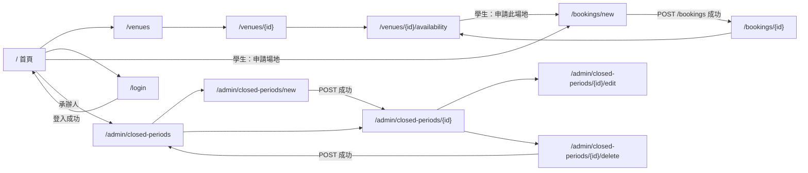

# Web Route 規格（Sprint 1）

- 對應 Task：T-001（設計）；實作：T-003（`/healthz`）、T-023（錯誤頁呈現、`ALL_ROUTERS`、route 覆蓋測試）、T-010、T-012、T-015、T-017、T-020
- 最後更新：2026-11-07（第 4 版：第 3 節補上 T-002 發現的樣板 context 缺口——錯誤頁變數 `request_id`、`error_kind`、錯誤頁不讀 flash（`skip_flash`）、`day_status_label` 由 T-017 註冊、Sprint 1 不提供 `role_label`）
- 前一版：2026-11-06（第 3 版：`DayStatus` 與優先規則對應 US-002 AC6～AC8；首頁未實作選單隱藏；POST 只接受 urlencoded）

## 1. 總則

- 全部為 Jinja2 SSR + HTML 表單，**Sprint 1 沒有 JSON API**（`/api/*` 不存在，存取一律 404）；`/docs`、`/redoc`、`/openapi.json` 關閉（404）。
- HTML 表單只能 GET / POST，因此「編輯」「刪除」以 `POST .../edit`、`POST .../delete` 表示；不使用 method override。GET route **不得有副作用**（Code Review 檢查項）。
- **所有 POST 都驗證 CSRF**（全域相依 `csrf_protect`，ADR-002）。缺少或錯誤 → `403` CSRF 錯誤頁，且不執行任何動作。Token 只經表單隱藏欄位 `csrf_token` 傳遞（不接受標頭）。
- **所有 POST 只接受 `application/x-www-form-urlencoded`**（其他 Content-Type → 415；多個 Content-Type 標頭 → 400；空本體可省略），欄位數上限 50；每個子 router 都必須各自宣告 `APIRouter(route_class=LimitedFormRoute)`，並加入 `ALL_ROUTERS`（ADR-002 2.1）。表單不得使用 `enctype="multipart/form-data"`。
- **測試要求（Security Review N-13，T-021）**：走訪 `app.router.routes` 加上 `app/routers/__init__.py` 的 `ALL_ROUTERS` 中每個 router 的 `.routes`（**不可**只走訪 `app.routes`，FastAPI 0.162 以 `include_router` 掛載的 route 不會直接列在其中），對所有接受 POST 的 route（路徑參數以 `1` 代入）不帶 Token 送出，全部必須回 `403`；並斷言收集到的 POST 路徑**包含**預期清單（`/login`、`/logout`、`/bookings`、`/admin/closed-periods`、`/admin/closed-periods/{period_id}/edit`、`/admin/closed-periods/{period_id}/delete`），避免走訪零個 route 時悄悄通過（ADR-002 2.1 第 3 點）。新增 router 必須加入 `ALL_ROUTERS`（`create_app` 只從清單掛載），新增 POST route 時應同步擴充預期清單。
- 權限欄位：
  - `公開`：不需登入。
  - `登入`：`require_login`；未登入 GET → `303 /login?next=<原路徑含查詢字串>`；未登入 POST（CSRF 已通過）→ `303 /login`（不帶 next）。Session 逾時 → 加 `reason=timeout`。
  - `student` / `staff`：`require_role(...)`，已登入但角色不符 → 拋 `PermissionDeniedError` → `403` 錯誤頁；**`access.denied` 由全域 handler 統一記錄**，`require_role` 本身不寫日誌。service 層仍會再檢查一次（AGENTS.md 2.3）。
- 成功的 POST 一律 `303 See Other`（PRG）。表單驗證失敗重新渲染同一表單並保留已填資料（密碼除外）。
- 路徑參數 `{venue_id}`、`{period_id}`、`{booking_id}` 宣告為 `int` 且 `Path(gt=0)`；非正整數 → `RequestValidationError` → 統一 `422` 錯誤頁（US-001 AC4）。
- 查詢參數需要友善錯誤訊息者（`week_start`、`date`）宣告為 `str | None`，由 service 解析驗證。
- 所有非 `/static/` 回應帶 `Cache-Control: no-store`（overview.md 第 8 節）。
- 所有導向的 `Location` 只用相對路徑。

## 2. Route 清單

### 2.1 公開與系統

| Method | Path | 權限 | CSRF | 說明 / 成功回應 | 錯誤回應 | Story / AC | Task |
|---|---|---|---|---|---|---|---|
| GET | `/` | 公開 | – | 首頁 `home.html`。未登入：場地清單入口、登入連結；已登入：顯示 `display_name` 與角色選單（學生：申請場地；承辦人：不開放期間管理）。Sprint 1 尚未實作的「我的申請」（US-005）、「待審核」（US-006）**隱藏**，不出現在選單 | – | US-013 AC1 | T-010 |
| GET | `/healthz` | 公開 | – | `200 text/plain` `ok`；不輸出版本或 DB 細節 | – | – | T-003 |
| GET | `/static/*` | 公開 | – | 靜態檔（不加 `no-store`） | 404 | – | T-002/T-003 |

### 2.2 認證（US-013）

| Method | Path | 權限 | CSRF | 說明 / 成功回應 | 錯誤回應 | AC | Task |
|---|---|---|---|---|---|---|---|
| GET | `/login` | 公開 | – | `auth/login.html`。**不建立 DB Session**；呼叫 `issue_login_csrf_token(request, response, now)`：沿用有效的登入前 nonce（沒有才產生新的），**每次**以同一 nonce 重新 `Set-Cookie` 刷新 `Max-Age`，再以 HMAC 產生登入前 CSRF Token 放入表單（ADR-002 4.2）。查詢參數：`next`（站內相對路徑，經 `is_safe_next()` 過濾後以 `next_path` 放入隱藏欄位，見 2.6）、`reason=timeout` → 顯示「登入已逾時，請重新登入」。已登入者 → `303 /` | – | AC6、AC8 | T-010 |
| POST | `/login` | 公開 | ✔（登入前 Token） | 表單 `username`、`password`、`next`。成功：`create_session_for_user(request, response, user_id)`（新 Session ID、新 CSRF Token；若帶有舊 Session Cookie 則一併刪除）、刪除 nonce Cookie → `303 <next 或 />`；記錄 `auth.login.success` | 失敗（帳號不存在、密碼錯、停用、鎖定、格式不符）**一律** `400` 重新渲染登入頁，訊息「帳號或密碼錯誤」；`username` 回填原始輸入**截斷至前 50 字**（autoescape）、`password` 不回填；回應內容除 CSRF Token 值外逐字相同（ADR-005）。雜湊名額已滿 → **`503`** `errors/503.html`＋`Retry-After`，在讀取帳號資料前發生、不消耗嘗試次數（ADR-005 §6） | AC1～AC4、AC7、AC8、AC10 | T-010 |
| POST | `/logout` | 需已登入 Session | ✔（Session Token） | `destroy_session(request, response)`：刪除伺服器端 Session、`Set-Cookie` 清除 → `303 /`；記錄 `auth.logout` | **無有效 Session**（未登入、已逾時）→ `403` CSRF 錯誤頁（`reason=no_session`，錯誤頁附「回首頁」連結）；Token 錯 → 403，Session 不變 | AC5、AC8 | T-010 |

### 2.3 場地與借用狀況（US-001、US-002）

| Method | Path | 權限 | CSRF | 說明 / 成功回應 | 錯誤回應 | AC | Task |
|---|---|---|---|---|---|---|---|
| GET | `/venues` | 公開 | – | `venues/list.html`：依類別（社團活動場地、擺攤場地）分組列出**啟用中**場地 | – | US-001 AC1、AC3 | T-012 |
| GET | `/venues/{venue_id}` | 公開 | – | `venues/detail.html`：名稱、類別、容納人數（NULL →「未提供」）、說明、可借用時段（`OPEN_TIME`–`CLOSE_TIME`）、連結至 `/venues/{venue_id}/availability` | 停用或不存在 → 404；非正整數 → 422 | US-001 AC2～AC4 | T-012 |
| GET | `/venues/{venue_id}/availability` | 公開 | – | `venues/availability.html`：單一場地週檢視。查詢參數 `week_start`（`YYYY-MM-DD`，任意日期正規化為該週週一；省略＝本週）。每日依 `DayAvailability.status` 標示（見下方優先規則）。學生登入時，**只在 `status=bookable` 的日期**顯示「申請此場地」連結 → `/bookings/new?venue_id=..&date=..` | 場地停用/不存在 → 404；`week_start` 無效 → **`422`，頁面改為本週並在頂部顯示**「日期格式錯誤或超出可查詢範圍（前後一年）」 | US-002 AC1～AC8、US-004 AC1 | T-017 |

週檢視 service（T-016，Code Review #11）：

```python
class AvailabilityService:
    def get_week(self, venue_id: int, week_start_raw: str | None, today: dt.date) -> WeekAvailability:
        """week_start_raw 為 None → 本週。

        Raises:
            NotFoundError: 場地停用或不存在。
            FieldErrors: {'week_start': '日期格式錯誤或超出可查詢範圍（前後一年）'}
                         ——格式不是 YYYY-MM-DD，或正規化後的週一不在
                         [monday(today − 365 天), monday(today + 365 天)]（含兩端）。
        """
```

- `monday(d) = d - timedelta(days=d.weekday())`。
- Route 捕捉 `FieldErrors` 後改呼叫 `get_week(venue_id, None, today)`，以 `422` 渲染本週並顯示錯誤訊息。
- `prev_week_start` / `next_week_start` 超出上述範圍時為 `None`（頁面不顯示該連結）。

```python
class PublicBookingSlot(BaseModel):     # 只含公開欄位（US-002 AC2）
    venue_name: str
    date: dt.date                       # APP_TIMEZONE
    start_time: dt.time
    end_time: dt.time
    activity_name: str
    club_name: str
    status: BookingStatus               # 只會是 pending / approved

class DayStatus(StrEnum):               # app/schemas/availability.py（T-016）
    CLOSED = 'closed'                   # 不開放日（US-002 AC4）——優先順序 1
    OUTSIDE_SEMESTER = 'outside_semester'   # 學期區間以外（AC6）——優先順序 2
    DEADLINE_PASSED = 'deadline_passed'     # 學期內、非不開放日，但 today > R-13 最晚申請日（含過去日期，AC8）——優先順序 3
    BOOKABLE = 'bookable'               # 學期內、非不開放日、today ≤ 最晚申請日（AC7、AC8）——優先順序 4

class DayAvailability(BaseModel):
    date: dt.date
    status: DayStatus                   # 依下方優先規則決定，單一值
    closed_reason_types: list[ClosedReasonType]   # 空 = 非不開放日；去重、依列舉順序；status=CLOSED 時必非空
    in_semester: bool                   # ADR-006；保留原始判斷，供測試與未來 US-018 使用
    bookings: list[PublicBookingSlot]   # 依 start_time 排序；任何 status 都列出既有佔用（尚未被取消者）

    @property
    def bookable(self) -> bool:         # 控制「申請此場地」連結（US-002 AC7）
        return self.status is DayStatus.BOOKABLE
```

**`DayAvailability.status` 優先規則（T-016 實作，對應 US-002 AC4、AC6～AC8）**——由上而下，第一個成立者即為結果：

| 順序 | 條件 | `status` | 整天 / 空閒時段的標示（T-017） | 「申請此場地」連結 |
|---|---|---|---|---|
| 1 | `closed_reason_types` 非空（不開放日，**即使同時在學期外**，AC6） | `closed` | 整天「不開放（原因類型）」 | 不顯示 |
| 2 | `not in_semester` | `outside_semester` | 整天「不開放（非學期期間）」 | 不顯示 |
| 3 | `not workday.can_apply(today, date)`（含過去日期） | `deadline_passed` | 空閒時段「已過申請期限」 | 不顯示 |
| 4 | 其他 | `bookable` | 空閒時段「可申請」 | 學生登入時顯示 |

- **「整天」標示的意思**（本表與 3.4 `day_status_label` 對照表通用）：在表頭下方的日狀態列顯示該日狀態，並把該日每個空閒時段區段標上同一標籤；**不是**用單一儲存格蓋住整天，既有佔用仍逐筆顯示、不被覆蓋（docs/design/sprint-01-page-flow.md §3.5）。
- 既有佔用（`bookings`）在任何 `status` 下都依其狀態標示「審核中」/「已核准」，覆蓋該時段的空閒標示。
- 此規則與 `BookingService.apply` 的檢查順序一致（不開放 → 學期 → R-13，overview.md 第 6 節）。
- 所有訪客（未登入、學生、承辦人）看到相同的 `status` 標示（AC8）；只有連結依角色顯示。

```python
class WeekAvailability(BaseModel):
    venue: PublicVenue
    week_start: dt.date                 # 週一
    week_end: dt.date                   # 週日
    prev_week_start: dt.date | None
    next_week_start: dt.date | None
    days: list[DayAvailability]         # 固定 7 筆
    open_time: dt.time                  # 08:00
    close_time: dt.time                 # 22:00
    slot_minutes: int                   # 30
```

> `status` / `bookable` 只用於顯示，不含個資；申請時 service 仍完整檢查所有規則。

### 2.4 不開放期間管理（US-017，承辦人）

全部 `require_role('staff')`：學生 → 403 + `access.denied`；未登入 → `303 /login?next=...`（AC6）。

| Method | Path | CSRF | 說明 / 成功回應 | 錯誤回應 | AC | Task |
|---|---|---|---|---|---|---|
| GET | `/admin/closed-periods` | – | `admin/closed_periods/list.html`：依 `start_date` 遞減列出；欄位：起日、迄日、原因類型、說明、操作（檢視、編輯、刪除） | – | AC1、AC4 | T-015 |
| GET | `/admin/closed-periods/new` | – | `admin/closed_periods/form.html`（新增模式） | – | AC1 | T-015 |
| POST | `/admin/closed-periods` | ✔ | `create()` → flash「已新增不開放期間，受影響的既有申請 N 筆」→ `303 /admin/closed-periods/{id}`；記錄 `closed_period.created` | 驗證失敗 → `422` 重新渲染表單、逐欄錯誤、保留資料 | AC1、AC3、AC5、AC7 | T-015 |
| GET | `/admin/closed-periods/{period_id}` | – | `admin/closed_periods/detail.html`：期間資料＋**受影響的既有申請**（`get_period()` 回傳的 `affected`；欄位：申請編號、場地、日期、時段、社團、活動名稱、狀態、申請人姓名）；取消連結待 US-012 | 不存在 → 404 | AC3 | T-015 |
| GET | `/admin/closed-periods/{period_id}/edit` | – | 表單（編輯模式，預填） | 404 | AC4 | T-015 |
| POST | `/admin/closed-periods/{period_id}/edit` | ✔ | 更新 → flash「已更新」→ `303 /admin/closed-periods/{id}`；記錄 `closed_period.updated` | 422 / 404 | AC4、AC5、AC7 | T-015 |
| GET | `/admin/closed-periods/{period_id}/delete` | – | `admin/closed_periods/confirm_delete.html`：確認頁（不用 JS confirm，配合 CSP） | 404 | AC4 | T-015 |
| POST | `/admin/closed-periods/{period_id}/delete` | ✔ | 刪除 → flash「已刪除」→ `303 /admin/closed-periods`；記錄 `closed_period.deleted` | 404 | AC4、AC7 | T-015 |

> 縮減順序（planning.md）啟動時：AC3 受影響清單可移除 detail 頁區塊；AC4「編輯」兩條 route 可延後。

Service 介面（T-013，Code Review #10）：

```python
class ClosedPeriodInput(BaseModel):
    start_date: dt.date
    end_date: dt.date
    reason_type: ClosedReasonType
    description: str = Field(min_length=1, max_length=100)
    # model_validator：start_date <= end_date 且 (end_date - start_date).days <= 365

class ClosedPeriodDetail(BaseModel):
    period: ClosedPeriodOut
    affected: list[AffectedApplication]   # 期間內 pending / approved 申請
    affected_count: int

class ClosedPeriodService:
    def __init__(self, session: Session, settings: Settings) -> None: ...
    # 管理（actor 必須為 staff，否則 PermissionDeniedError）
    def list_periods(self, actor: CurrentUser) -> list[ClosedPeriodOut]: ...
    def get_period(self, actor: CurrentUser, period_id: int) -> ClosedPeriodDetail: ...
    def create(self, actor: CurrentUser, data: ClosedPeriodInput) -> ClosedPeriodDetail: ...
    def update(self, actor: CurrentUser, period_id: int, data: ClosedPeriodInput) -> ClosedPeriodOut: ...
    def delete(self, actor: CurrentUser, period_id: int) -> None: ...
    # 內部查詢（無 actor；供 T-016、T-019，回傳資料不含個資）
    def closures_between(self, start: dt.date, end: dt.date) -> dict[dt.date, list[ClosedReasonType]]: ...
    def closures_on(self, day: dt.date) -> list[ClosedReasonType]: ...   # 空 list = 開放
```

### 2.5 借用申請（US-004，學生）

| Method | Path | 權限 | CSRF | 說明 / 成功回應 | 錯誤回應 | AC | Task |
|---|---|---|---|---|---|---|---|
| GET | `/bookings/new` | `student` | – | `bookings/form.html`。查詢參數 `venue_id`、`date` 可預填（無效值直接忽略）。社團下拉只列 `club_repository.list_managed_by(user)` 的啟用中社團；場地下拉只列啟用中場地；時間下拉 08:00～22:00 每 30 分鐘。沒有負責任何社團時顯示「您目前不是任何社團的負責人，無法申請」且不顯示表單 | 未登入 → 303 /login?next=…（AC2）；staff → 403（AC4） | AC1、AC2、AC4 | T-020 |
| POST | `/bookings` | `student` | ✔ | `BookingService.apply(actor, payload, today)` → `303 /bookings/{id}`；記錄 `booking.created` | 見下表 | AC1～AC17 | T-020 |
| GET | `/bookings/{booking_id}` | `student` | – | `bookings/submitted.html`：申請編號、場地、日期、時段、社團、活動名稱、狀態「審核中」、「已送出，待課外組承辦人審核（R-12）」與「未核准前不得使用場地（R-16）」。**只有 `applicant_id == current_user.id` 可看** | 不存在 → 404（不記錄）；存在但非本人 → **404** 並記錄 `access.denied`（`reason=not_owner`，見 error-handling.md 隱藏規則）；staff → 403 | AC1 | T-020 |

`POST /bookings` 錯誤對照（重新渲染 `bookings/form.html` 並保留已填資料，除非另註）：

| 情況 | HTTP | 顯示 | 來源例外 | AC |
|---|---|---|---|---|
| 缺少/錯誤 CSRF | 403 | CSRF 錯誤頁（不重新渲染表單） | `CSRFError` | AC16 |
| 未登入（帶有效登入前 Token） | 303 → `/login` | – | `LoginRequired` | AC2 |
| 角色為 staff | 403 | 403 錯誤頁 | `PermissionDeniedError` | AC4 |
| 欄位格式（長度、人數範圍、時間非 30 分倍數、開始不早於結束、日期格式） | 422 | 逐欄錯誤 | Pydantic `ValidationError` → `FieldErrors` | AC9、AC15 |
| 非所選社團負責人（竄改 `club_id`） | 403 | 403 錯誤頁 + `access.denied` | `PermissionDeniedError` | AC3 |
| 社團已停用 | 422 | `club_id` 欄位錯誤「此社團目前無法申請」 | `FieldErrors` | – |
| 場地不存在或停用 | 422 | `venue_id` 欄位錯誤「場地不存在或已停用」 | `FieldErrors` | AC14 |
| 人數超過容納人數 | 422 | `expected_attendees` 欄位錯誤「超過場地容納人數（N 人）」 | `FieldErrors` | AC15 |
| 超出 08:00–22:00 | 422 | 頂部「可借用時段為 08:00–22:00，且須於 22:00 前撤場」 | `BusinessRuleError('outside_opening_hours')` | AC8 |
| 不開放日 | 422 | 頂部「該日期不開放借用（原因：考試週）」 | `BusinessRuleError('closed_date')` | AC10 |
| 學期區間外 | 422 | 頂部「該日期不在學期期間，暫不開放借用」 | `BusinessRuleError('outside_semester')` | AC17 |
| 未達 5 個工作天 | 422 | 頂部「一般校內活動須於活動前 5 天（不含假日）提出申請，本活動最晚申請日為 YYYY-MM-DD」 | `BusinessRuleError('apply_deadline_passed')` | AC11 |
| 時段重疊 | 409 | 頂部「該時段已被借用」 | `BookingConflictError` | AC5、AC7 |
| 寫鎖逾時 | 503 | 頂部「系統忙碌，請稍後再試」 | `ServiceBusyError` | – |

申請表單 schema（T-019 `app/schemas/booking.py`）：

```python
import datetime as dt

class BookingApplicationForm(BaseModel):
    model_config = ConfigDict(str_strip_whitespace=True, extra='forbid')
    club_id: int = Field(gt=0)
    venue_id: int = Field(gt=0)
    date: dt.date                                # ISO YYYY-MM-DD
    start_time: dt.time                          # HH:MM，minute ∈ {0, 30}，second == microsecond == 0
    end_time: dt.time                            # 同上；允許 22:00；不接受 24:00
    activity_name: str = Field(min_length=1, max_length=100)
    activity_description: str = Field(min_length=1, max_length=1000)
    expected_attendees: int = Field(ge=1, le=9999)
    # model_validator：start_time < end_time（同一天，因此不可能跨日，AC8「跨日」亦由此拒絕）

class BookingService:
    def apply(self, actor: CurrentUser, payload: BookingApplicationForm, today: dt.date) -> BookingApplicationCreated: ...
    def get_own_application(self, actor: CurrentUser, booking_id: int) -> BookingApplicationView: ...
        # 不存在 → NotFoundError；存在但非本人 → PermissionDeniedError(reason='not_owner', conceal=True)
```

### 2.6 `next` 參數（防 Open Redirect，CWE-601）

`is_safe_next(value: str) -> bool`：必須以單一 `/` 開頭、不以 `//` 或 `/\` 開頭、不含 `\`、控制字元、`://`，長度 ≤ 512，且 `urllib.parse.urlsplit` 的 `scheme` 與 `netloc` 皆為空。不符合 → 改用 `/`。

樣板輸出規則（Security Review 建議，T-010）：

- `GET /login` 與 `POST /login` 失敗重新渲染時，route 先以 `is_safe_next()` 過濾，**不合格就改為 `/`**，再以 context 變數 `next_path: str`（已過濾值）傳給 `auth/login.html`；樣板只把它放在 `<input type="hidden" name="next" value="{{ next_path }}">`（加雙引號、autoescape）。樣板**不得**直接讀 `request.query_params['next']`。
- `next`（含過濾後的值）**永遠不得**出現在 `<a href>`、`<form action>`、`<meta http-equiv="refresh">` 或任何 URL 屬性中。
- 測試（T-010）：`/login?next=//evil.example`、`next=javascript:alert(1)`、`next=/\evil` 時，回應中 `name="next"` 的值為 `/`，且回應本體不含該原始字串。

## 3. 樣板 context 約定（T-002、T-003、T-007、T-008、T-017、T-023 共用）

### 3.1 全域變數（context processor）

由 `app/core/templating.py` 的 context processor 注入：

| 變數 | 型別 | 來源 | 說明 |
|---|---|---|---|
| `request` | `Request` | Starlette | 必填 |
| `current_user` | `CurrentUser | None` | `getattr(request.state, 'current_user', None)` | 欄位：`id`、`username`、`display_name`、`role`、`is_staff`、`is_student`。不含 `password_hash` |
| `csrf_token` | `str | None` | 已登入：`request.state.session.csrf_token`；`/login` 頁：route 產生的登入前 Token（以 `request.state.login_csrf_token` 傳入） | 表單以 `{{ forms.csrf_field() }}` 輸出 `<input type="hidden" name="csrf_token" value="{{ csrf_token }}">` |
| `messages` | `list[FlashMessage]` | 已登入時讀取後即從 Session 移除；未登入為空 list；**`request.state.skip_flash` 為真時一律空 list 且不呼叫 `pop_flashes`**（見 3.3） | `FlashMessage(level: Literal['success','info','warning','error'], text: str)` |
| `app_timezone` | `str` | Settings | 顯示用 |

- **保留名稱（覆寫順序）**：Starlette `Jinja2Templates.TemplateResponse` 會先放入 route 傳入的 `context`，再以每個 context processor 的回傳值 `update`，**processor 的鍵會覆寫 route 傳入的同名鍵**。因此：
  - **`current_user`、`csrf_token`、`messages`、`app_timezone` 為保留名稱**（`request` 由 Starlette 放入，亦視為保留）。route 與 error handler **不得**在 context 傳入這些名稱（傳了也會被覆蓋而無效，且會誤導閱讀者）；Code Review 檢查項。需要改變其值時改設 `request.state`（例如 `login_csrf_token`、`skip_flash`）。
  - context processor 只能回傳上述 4 個鍵，**不得**回傳 `request_id`、`error_kind`、`form`、`errors` 或任何頁面專用變數（3.2 的變數不是保留名稱，由 route / handler 傳入且不會被覆蓋）。
- **實作分工**：T-003 建立 context processor，`messages` 先固定回傳 `[]`（`pop_flashes` 尚未存在）。**T-007** 負責接上 `pop_flashes(request)`，並同時實作 3.3 的 `skip_flash` 檢查（旗標為真時不呼叫 `pop_flashes`）。T-023 負責在錯誤頁 handler 設定旗標。
- 所有 `request.state` 屬性一律以 `getattr(request.state, '<name>', None)`（或 `False`）讀取，缺少時視為未登入 / 無值（error-handling.md 3.2）。

### 3.2 頁面專用變數

| 變數 | 型別 | 使用頁面 | 說明 |
|---|---|---|---|
| `form` | `dict[str, str]` | 表單頁 | 已填值（密碼除外） |
| `next_path` | `str` | `auth/login.html` | 已經 `is_safe_next()` 過濾的站內相對路徑（不合格為 `/`），只能放在隱藏欄位 `next`（2.6） |
| `errors` | `dict[str, str]` | 表單頁 | 欄位名 → 訊息；全域錯誤用鍵 `__all__` |
| `request_id` | `str | None` | `errors/*.html` | 錯誤代碼。由 T-023 的每個錯誤頁 handler **明確傳入** `getattr(request.state, 'request_id', None)`。樣板 fallback：未傳入（未定義或空值）時讀 `request.state.request_id`；兩者皆無則不顯示錯誤代碼（`errors/_layout.html` 已如此實作） |
| `error_kind` | `Literal['csrf'] | None` | 只用於 `errors/403.html` | `csrf_error_handler` 傳 `'csrf'` → 顯示「表單已失效，請重新整理頁面後再試」；`permission_denied_handler` 傳 `None`（或不傳）→ 顯示「您沒有權限執行此操作」。樣板只比對 `== 'csrf'`，其他值一律視為權限訊息 |

- **錯誤頁訊息寫死於樣板**：handler 不得傳入例外的 `message`、`reason`、請求路徑或使用者輸入；只允許傳入上表的 `request_id`、`error_kind`（error-handling.md 第 1 節原則 3）。`CSRFError.reason`（含 `no_session`）只寫入 `csrf.failed` 日誌，不影響畫面（登出時無 Session 也顯示同一 CSRF 訊息與「回首頁」連結）。
- **`request_id` 一律由伺服器隨機產生**：`RequestIdMiddleware`（T-023）以 `secrets.token_hex(n)` 或 `uuid.uuid4().hex` 產生（格式為小寫 hex，例如 `secrets.token_hex(8)` 的 16 字元），同時寫入 contextvar（日誌用）與 `scope['state']['request_id']`（使 `request.state.request_id` 在 `ServerErrorMiddleware` 執行的 500 handler 中仍可讀取）。**不得**採用用戶端送來的 `X-Request-ID`、`X-Correlation-ID` 等任何請求標頭（避免反射內容與日誌偽造，CWE-117）。樣板仍經 autoescape 輸出。測試（T-023）：送出 `X-Request-ID: <script>` 時，錯誤頁與日誌中的 `request_id` 不是該值且符合 `^[0-9a-f]+$`。

### 3.3 錯誤頁不讀 flash（`skip_flash`）

- T-023 的**每個**渲染錯誤頁樣板的 handler（400、403、404〔含 405→404、conceal〕、413〔chunked〕、422、500、503 頁）在呼叫 `TemplateResponse` **之前**設定 `request.state.skip_flash = True`；**不得**在 context 傳入 `messages`（保留名稱，見 3.1）。
- context processor 讀 `messages` 時（T-007 實作）：`getattr(request.state, 'skip_flash', False)` 為真 → 回傳 `[]`，**不呼叫 `pop_flashes()`**、不存取 DB；否則依 ADR-001 呼叫 `pop_flashes(request)`。T-003 階段 `messages` 固定為 `[]`，天然符合本規則。
- 理由：(1) 500 可能由 DB 故障引起，錯誤頁再碰 DB 會二次失敗並落到純文字 fallback；(2) 錯誤頁若消耗 flash，使用者會在錯誤頁「吃掉」原本要在下一頁看到的訊息。
- 樣板端：`base.html` 對 `messages` 未定義或為 `None` 已防護（視為空 list），樣板不依賴 `messages` 一定存在。
- 測試（T-023）：已登入且 Session 中有 flash 時觸發 404 / 500 → 錯誤頁不顯示 flash、`user_sessions.data` 的 flash 仍保留（下一個正常頁面才顯示）；monkeypatch `pop_flashes` 使其拋例外 → 錯誤頁仍正常渲染。

### 3.4 Jinja2 filter

| filter | 輸入 | 輸出 | 註冊於 `app/core/templating.py` 的 Task |
|---|---|---|---|
| `local_dt` | timezone-aware UTC `datetime` | `APP_TIMEZONE` 的 `YYYY-MM-DD HH:MM` | T-003 |
| `local_date` | `datetime` / `date` | `YYYY-MM-DD` | T-003 |
| `hhmm` | `time` | `HH:MM` | T-003 |
| `status_label` | `BookingStatus`（**只**接受申請狀態） | 審核中 / 已核准 / 已駁回 / 已取消 | T-003 |
| `reason_type_label` | `ClosedReasonType` | 國定假日 / 考試週 / 大型考試 / 其他（erd.md `closed_periods.reason_type`） | T-003 |
| `category_label` | `VenueCategory` | 社團活動場地 / 擺攤場地 | T-003 |
| `weekday_label` | `date` | 一～日 | T-003 |
| **`day_status_label`** | `DayStatus`（`app/schemas/availability.py`） | 見下表 | **T-017**（不屬 T-003） |

`day_status_label` 對照（依 2.3 優先規則與 US-002 AC4、AC6～AC8）：

| `DayStatus` | 標籤 | 用途 |
|---|---|---|
| `closed` | `不開放` | 整天標示；樣板再接原因：`不開放（{{ reasons }}）`，`reasons` 為 `closed_reason_types` 經 `reason_type_label` 以「、」串接（例如「不開放（考試週）」，AC4） |
| `outside_semester` | `不開放（非學期期間）` | 整天標示（AC6） |
| `deadline_passed` | `已過申請期限` | 該日空閒時段標示（AC8，含過去日期） |
| `bookable` | `可申請` | 該日空閒時段標示（AC1、AC8） |

- **歸屬**：`DayStatus` 由 T-016 定義，T-003 開發時尚不存在。為避免 T-003 依賴未存在的 enum，`day_status_label` 由 **T-017** 在 `app/core/templating.py` 註冊（`templates.env.filters['day_status_label'] = ...`，對照表放在 `app/core/templating.py` 或 `app/schemas/availability.py` 旁的單一 dict，二選一由 T-017 決定，但不得寫死於樣板）。T-003 **不需要**實作此 filter。
- 遇到未知值（理論上不會發生）回傳空字串，不拋例外、不輸出原始值。
- 佔用時段（「審核中」「已核准」）仍用 `status_label`，與 `day_status_label` 無關（2.3：佔用覆蓋空閒標示）。
- **`status_label` 不得擴充為同時接受 `DayStatus`**：兩者值域不同（`DayStatus` 沒有對應的申請狀態），合併會讓型別檢查失效。

### 3.5 角色名稱

**Sprint 1 不顯示角色名稱，不提供 `role_label` filter。** US-013 AC1 只要求「顯示使用者名稱與角色對應的選單」：導覽列顯示 `current_user.display_name`，角色以選單項目（學生「申請場地」、承辦人「不開放期間管理」）反映即可（`base.html` 現行做法）。日後若需顯示「學生 / 承辦人」，再新增 `role_label`（對照 `UserRole`）並更新本節。

## 4. 表單欄位名稱（單一來源）

| 表單 | 欄位 `name` |
|---|---|
| 共用 | `csrf_token` |
| 登入 | `username`（`autocomplete="username"`、`maxlength="50"`）、`password`（`autocomplete="current-password"`、`maxlength="128"`）、`next`（`type="hidden"`，值只能是已過濾的 `next_path`，2.6） |
| 不開放期間 | `start_date`、`end_date`（`type="date"`）、`reason_type`（`<select>`：`national_holiday`/`exam_week`/`major_exam`/`other`）、`description` |
| 借用申請 | `club_id`、`venue_id`、`date`、`start_time`、`end_time`、`activity_name`、`activity_description`、`expected_attendees` |
| 週檢視（GET） | `week_start` |

## 5. 樣板清單

| 樣板 | Route | Task |
|---|---|---|
| `base.html`、`macros/forms.html` | 全部 | T-002 |
| `errors/400.html`、`errors/403.html`、`errors/404.html`、`errors/413.html`、`errors/422.html`、`errors/500.html`、`errors/503.html`（皆附「回首頁」連結） | 錯誤處理 | T-002（400、413、503 為本設計新增） |
| `home.html` | `/` | T-010 |
| `auth/login.html` | `/login` | T-010 |
| `venues/list.html`、`venues/detail.html` | `/venues*` | T-012 |
| `venues/availability.html` | `/venues/{id}/availability` | T-017 |
| `admin/closed_periods/list.html`、`form.html`、`detail.html`、`confirm_delete.html` | `/admin/closed-periods*` | T-015 |
| `bookings/form.html`、`bookings/submitted.html` | `/bookings*` | T-020 |

## 6. 頁面流程


