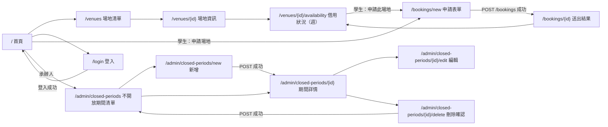
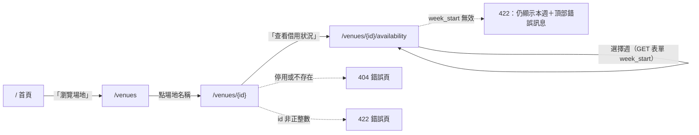
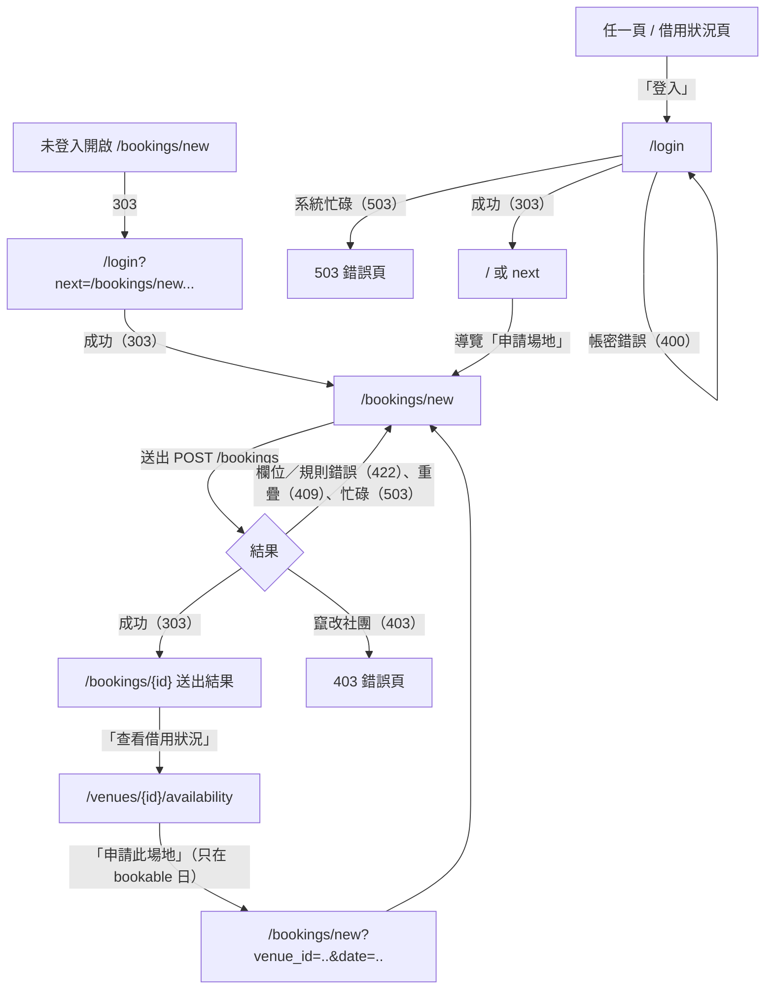
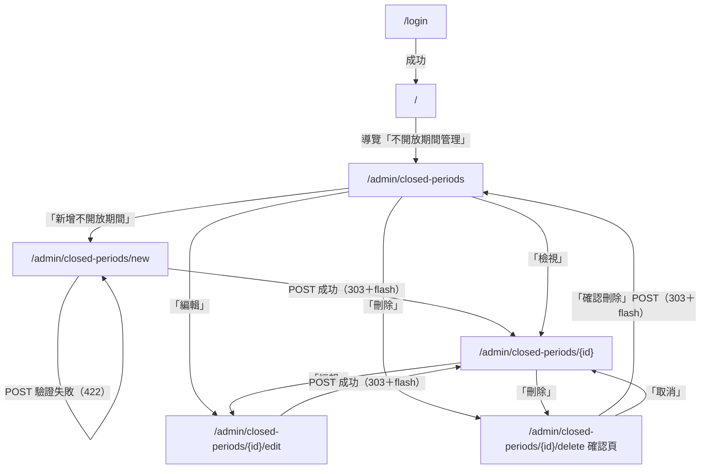

# Sprint 1 頁面流程與 Wireframe(線框圖)

- 對應 Task：T-002；Story：US-013、US-001、US-017、US-002、US-004
- 依據：`docs/architecture/routes.md`（第 2、5、6 節）、`docs/architecture/error-handling.md`
- 共用規範：`docs/design/style-guide.md`
- 最後更新：2026-11-07（第 2 版：依 Code Review 修正週檢視——不開放日不得以單一儲存格蓋住既有佔用；圖例改由 filter 產生；對齊 routes.md 第 4 版）

> 本文件只描述版面與流程；路由、HTTP 狀態碼、權限以 routes.md 為準。若兩者不一致，以 routes.md 為準並回報 UI/UX Designer 修正本文件。

## 1. 角色與導覽列

導覽列由 `base.html` 依 `current_user` 產生，所有頁面相同：

| 身分 | 導覽列項目 | 右側 |
|---|---|---|
| 訪客（`current_user` 為 None／未定義，含 500 頁） | 場地清單 | 「登入」按鈕 |
| 學生（`is_student`） | 場地清單、申請場地 | 姓名、「登出」按鈕（POST） |
| 承辦人（`is_staff`） | 場地清單、不開放期間管理 | 姓名、「登出」按鈕（POST） |

- Sprint 1 尚未實作的「我的申請」（US-005）、「待審核」（US-006）**完全不顯示**（不顯示「即將推出」、不放連結；US-013 AC1）。
- 目前所在頁面以 `aria-current` 標示（粗體＋底線，不只靠顏色）。
- 手機寬度時導覽列自動換行，不使用需要 JavaScript 的漢堡選單。

## 2. 頁面流程

### 2.1 總覽（與 routes.md 第 6 節一致）



### 2.2 訪客：場地清單 → 場地資訊 → 借用狀況（US-001、US-002）



### 2.3 學生：登入 → 申請 → 結果（US-013、US-004）



### 2.4 承辦人：登入 → 不開放期間管理（US-013、US-017）



### 2.5 登出

導覽列「登出」按鈕為 `POST /logout` 表單（含 `csrf_token`）→ 303 `/`。無有效 Session 時為 403 錯誤頁（「表單已失效…」＋回首頁）。

## 3. Wireframe

圖例：`[按鈕]`、`<連結>`、`(____)` 輸入框、`[v]` 下拉選單、`{badge}` 狀態標籤。所有頁面共用下列外框，以下各頁只畫 `<main>` 內容。

### 3.0 共用外框（base.html）

```
桌機（≥ 64rem）
┌──────────────────────────────────────────────────────────────────────┐
│ <跳到主要內容>（只在鍵盤聚焦時出現）                                     │
├──────────────────────────────────────────────────────────────────────┤
│ 淡江場地預約系統   <場地清單> <申請場地>             王小明  [登出]    │ ← 深藍頁首
├──────────────────────────────────────────────────────────────────────┤
│ ┌ flash（success／info／warning／error，可多則）────────────────────┐ │
│ │ 已新增不開放期間，受影響的既有申請 2 筆                            │ │
│ └──────────────────────────────────────────────────────────────────┘ │
│                                                                      │
│                                                   │
│                                                                      │
├──────────────────────────────────────────────────────────────────────┤
│ 淡江大學學生活動場地借用系統・時間皆以 Asia/Taipei 時區顯示              │ ← 頁尾
└──────────────────────────────────────────────────────────────────────┘

手機（< 40rem）
┌────────────────────────────┐
│ 淡江場地預約系統            │
│            王小明  [登出]   │
│ <場地清單> <申請場地>        │ ← 自動換行
├────────────────────────────┤
│ 內容（單欄）                 │
└────────────────────────────┘
```

### 3.1 首頁 `/`（`home.html`，T-010）

```
訪客                                   學生 / 承辦人（已登入）
┌──────────────────────────────┐       ┌──────────────────────────────┐
│ # 淡江場地預約系統             │       │ # 王小明，您好                 │
│ 查詢學生活動場地借用狀況，      │       │                              │
│ 社團負責人可線上申請借用。      │       │ ## 常用功能                   │
│                              │       │ ┌────────┐ ┌────────┐         │
│ [瀏覽場地]  [登入]             │       │ │場地清單 │ │申請場地 │（學生）  │
│                              │       │ └────────┘ └────────┘         │
│                              │       │ ┌────────┐ ┌──────────────┐   │
│                              │       │ │場地清單 │ │不開放期間管理 │（承辦人）│
└──────────────────────────────┘       └──────────────────────────────┘
```

- 功能卡片使用 `.card-list`；只列出 Sprint 1 已實作的功能。

### 3.2 登入 `/login`（`auth/login.html`，T-010）

```
┌──────────────────────────────┐
│ # 登入                        │
│ ┌ info ────────────────────┐ │ ← reason=timeout 時：「登入已逾時，請重新登入」
│ └──────────────────────────┘ │
│ ┌ error-summary ───────────┐ │ ← 失敗時（400）：errors.__all__「帳號或密碼錯誤」
│ │ 送出失敗，請修正以下問題   │ │
│ │ 帳號或密碼錯誤             │ │
│ └──────────────────────────┘ │
│ 帳號（必填）                  │
│ (____________)               │ ← username，maxlength=50，autocomplete=username
│ 密碼（必填）                  │
│ (____________)               │ ← password，不回填
│ [登入]                        │
└──────────────────────────────┘
```

- 隱藏欄位：`csrf_token`（登入前 Token）、`next`（值為 route 已以 `is_safe_next()` 過濾的 `next_path`；`next` 不得出現在任何 `<a href>`、`<form action>`，routes.md 2.6）。
- 登入失敗訊息放在 `errors['__all__']`，**不可**標示在特定欄位（避免暗示是帳號錯還是密碼錯）。

### 3.3 場地清單 `/venues`（`venues/list.html`，T-012）

```
┌──────────────────────────────────────────────┐
│ # 場地清單                                     │
│ 依類別列出目前開放借用的場地。                    │
│                                              │
│ ## 社團活動場地            ← category_label     │
│ ┌──────────┐ ┌──────────┐ ┌──────────┐        │
│ │<學生活動中心>│ │<驚聲廣場> │ │<同舟廣場> │       │ ← 手機 1 欄、平板 2 欄、桌機 3 欄
│ │容納 300 人 │ │容納：未提供│ │…         │        │
│ └──────────┘ └──────────┘ └──────────┘        │
│ ## 擺攤場地                                    │
│ ┌──────────┐                                  │
│ │<海報街>   │                                  │
│ └──────────┘                                  │
└──────────────────────────────────────────────┘
```

### 3.4 場地資訊 `/venues/{id}`（`venues/detail.html`，T-012）

```
┌──────────────────────────────────────────────┐
│ <場地清單> / 驚聲廣場            ← breadcrumb    │
│ # 驚聲廣場                                     │
│ 類別        社團活動場地                        │ ← .detail-list（手機為上下排列）
│ 容納人數    未提供                              │
│ 可借用時段  08:00–22:00                         │
│ 說明        ……                                 │
│                                              │
│ [查看借用狀況]                                  │
└──────────────────────────────────────────────┘
```

### 3.5 借用狀況（週）`/venues/{id}/availability`（`venues/availability.html`，T-017）

```
┌────────────────────────────────────────────────────────────────────────┐
│ <場地清單> / <驚聲廣場> / 借用狀況                                          │
│ # 驚聲廣場 借用狀況                                                        │
│ ┌ error-summary（只在 week_start 無效時，422）──────────────────────────┐ │
│ │ 日期格式錯誤或超出可查詢範圍（前後一年）                                  │ │
│ └────────────────────────────────────────────────────────────────────┘ │
│ 2026-12-28（一）～ 2027-01-03（日）                                        │
│ <‹ 上一週>                                        <下一週 ›>              │ ← None 時不顯示
│ 選擇週：(2026-12-28) [查詢]                       ← GET 表單 name=week_start │
│                                                                        │
│ 圖例：{day_status_label × 4} {status_label × 2}   ← 走訪列舉產生，不寫死文字  │
│                                                                        │
│ ┌ 可水平捲動 ───────────────────────────────────────────────────────────┐ │
│ │ 時段     │ 12/28（一）     │ 12/29（二）    │ 12/30（三）       │ … │ 01/03（日）         │ │ ← thead 第 1 列：日期
│ │ 當日狀態 │ {已過申請期限}   │ {可申請}       │ {不開放（考試週）}  │   │ {不開放（非學期期間）}│ │ ← thead 第 2 列：整天狀態
│ │          │                 │ <申請此場地>   │                  │   │                    │ │ ← 只在 bookable 且學生登入
│ │ 08:00    │ {已過申請期限}   │ {可申請}       │ {不開放（考試週）}  │   │ {不開放（非學期期間）}│ │ ← 連續空閒時段合併為一格
│ │ 08:30    │ （rowspan 全天） │ （rowspan）    │ （rowspan 08–10） │   │ （rowspan 08–14）   │ │
│ │ 10:00    │                 │ {已核准}       │ {已核准}          │   │                    │ │
│ │  ~12:00  │                 │ 吉他之夜／吉他社 │ 期末成果展／熱舞社  │   │                    │ │ ← 不開放日仍顯示既有佔用
│ │ 12:00    │                 │ {可申請}       │ {不開放（考試週）}  │   │                    │ │
│ │ 14:00    │                 │ {審核中}       │ （rowspan 12–22） │   │ {審核中}            │ │ ← 非學期日亦同
│ │  ~16:00  │                 │ 社課／吉他社    │                  │   │ 寒訓說明會／攝影社   │ │
│ │ …        │                 │               │                  │   │ {不開放（非學期期間）}│ │
│ └────────────────────────────────────────────────────────────────────┘ │
└────────────────────────────────────────────────────────────────────────┘
```

**範例資料（可直接作為 T-017 / T-022 的測試資料；與 US-002 AC6 同一週）**

- 今天：2026-12-22（二）；場地：驚聲廣場；查詢 `week_start=2026-12-28`。
- 不開放期間：2026-12-30～2026-12-30，`reason_type=exam_week`（承辦人事後新增，因此當天已有核准借用）。
- 學期區間（ADR-006）：9/1～12/31，因此 2027-01-01～01-03 為 `outside_semester`。

| 日期 | `DayStatus` | 判斷依據 | 既有佔用 |
|---|---|---|---|
| 2026-12-28（一） | `deadline_passed` | 最晚申請日 2026-12-21（往前 5 個工作天：12/25、24、23、22、21），今天 12/22 已超過 | 無 |
| 2026-12-29（二） | `bookable` | 最晚申請日 2026-12-22（12/28、25、24、23、22），今天 12/22 ≤ 最晚申請日 | `approved` 10:00–12:00 吉他之夜／吉他社；`pending` 14:00–16:00 社課／吉他社 |
| 2026-12-30（三） | `closed`（`exam_week`） | 不開放期間（優先順序 1） | `approved` 10:00–12:00 期末成果展／熱舞社 |
| 2026-12-31（四） | `bookable` | 最晚申請日 2026-12-24 | 無 |
| 2027-01-01（五）～01-02（六） | `outside_semester` | 學期區間外 | 無 |
| 2027-01-03（日） | `outside_semester` | 學期區間外 | `pending` 14:00–16:00 寒訓說明會／攝影社（直接寫入的測試資料，用來驗證非學期日仍顯示佔用） |

- 表格：`<table class="data-table week-table">`。`<thead>` 兩列：
  1. 日期列：左上角 `<th scope="col">時段</th>`，其餘 `<th scope="col">` 為日期（`local_date`／`weekday_label`）。
  2. 當日狀態列：`<th scope="row">當日狀態</th>`，每天一格 `<td>`，顯示該日 `DayStatus` 標籤（`day_status_label`；`closed` 另接原因）；`bookable` 且學生登入時在此格放「申請此場地」連結。
- `<tbody>`：列標題 `<th scope="row">` 為時段（`hhmm`），每列 30 分鐘。
  - **既有佔用在任何 `DayStatus` 下都照常顯示**（routes.md 2.3、US-002 AC8）：以 `rowspan` 跨越其時長，顯示 `{status_label}`、活動名稱、社團名稱（只顯示 US-002 AC2 的公開欄位）。
  - **只合併空閒時段**：同一天中連續的空閒時段以 `rowspan` 合併為一格，顯示該日的 `day_status_label`（`closed` 另接原因）。不開放日／非學期日因此可能被佔用切成多段，每段都再次標示「不開放…」。
  - 不得以單一儲存格覆蓋整天（會把該日既有佔用藏起來）。
- 第一欄（含左上角表頭格）在水平捲動時固定（sticky）。
- 表格外層 `<div class="table-scroll" role="region" aria-label="驚聲廣場 2026-12-28 週借用狀況" tabindex="0">`，讓鍵盤使用者可捲動。
- 圖例：由 route 傳入 `DayStatus` 全部成員與佔用狀態（`pending`、`approved`）的清單（變數名稱由 T-017 決定並補入 routes.md 3.2），樣板以迴圈分別套 `day_status_label`／`status_label` 產生 `<span class="badge badge--{{ s }}">`，**不寫死任何標籤文字**。
- 每個狀態都有**文字**標籤，顏色只是輔助（WCAG 1.4.1）。
- 「申請此場地」連結文字需包含日期給螢幕閱讀器，例如 `申請此場地<span class="visually-hidden">（2026-12-29）</span>`。
- 手機（< 40rem）：表格保持完整、水平捲動（最小寬 48rem）；週切換連結與查詢表單在表格之上。

### 3.6 申請表單 `/bookings/new`（`bookings/form.html`，T-020）

```
┌──────────────────────────────────────────────┐
│ # 申請借用場地                                  │
│ ┌ notice ──────────────────────────────────┐  │
│ │ 送出後需經課外組承辦人審核；未核准前不得使用場地。│  │
│ └──────────────────────────────────────────┘  │
│ ┌ error-summary（422／409／503 時）────────────┐ │
│ │ 該時段已被借用        ← errors.__all__        │ │
│ │ • <活動名稱不可空白>  ← 連結到 #field-…        │ │
│ └──────────────────────────────────────────┘  │
│ 社團（必填）      [吉他社          v]  club_id  │
│ 場地（必填）      [驚聲廣場        v]  venue_id │
│ 日期（必填）      (2026-11-16)          date    │ ← type=date
│ 開始時間（必填）  [18:00 v]   結束時間 [20:00 v]  │ ← .field-row，手機上下排列
│ 活動名稱（必填）  (________________)           │ ← maxlength=100
│ 活動說明（必填）  (________________)           │ ← textarea，maxlength=1000
│                  (________________)           │
│ 預估人數（必填）  (____)                       │ ← type=number min=1 max=9999
│ [送出申請]  <取消>                              │
└──────────────────────────────────────────────┘

沒有負責任何社團時：
┌──────────────────────────────────────────────┐
│ # 申請借用場地                                  │
│ ┌ notice ──────────────────────────────────┐  │
│ │ 您目前不是任何社團的負責人，無法申請            │  │
│ └──────────────────────────────────────────┘  │
│ <回場地清單>                                    │
└──────────────────────────────────────────────┘
```

### 3.7 送出結果 `/bookings/{id}`（`bookings/submitted.html`，T-020）

```
┌──────────────────────────────────────────────┐
│ # 申請已送出                                   │
│ 已送出，待課外組承辦人審核（R-12）。              │ ← 頁面本文（非 flash）
│ 申請編號   12                                  │
│ 狀態       {審核中}          ← status_label     │
│ 場地 / 日期 / 時段 / 社團 / 活動名稱              │
│ ┌ notice ──────────────────────────────────┐  │
│ │ 未核准前不得使用場地（R-16）                  │  │
│ └──────────────────────────────────────────┘  │
│ [查看借用狀況]  <回首頁>                         │
└──────────────────────────────────────────────┘
```

### 3.8 不開放期間清單 `/admin/closed-periods`（`admin/closed_periods/list.html`，T-015）

```
┌──────────────────────────────────────────────────────────────┐
│ # 不開放期間管理                         [新增不開放期間]         │
│ ┌ 可水平捲動 ───────────────────────────────────────────────┐ │
│ │ 起日       │ 迄日       │ 原因類型 │ 說明          │ 操作        │ │
│ │ 2026-12-14 │ 2026-12-27 │ 考試週   │ 期末考週及前一週│ <檢視><編輯><刪除>│ │
│ │ 2026-12-25 │ 2026-12-25 │ 國定假日 │ 行憲紀念日     │ <檢視><編輯><刪除>│ │
│ └──────────────────────────────────────────────────────────┘ │
│ （沒有資料時：「目前沒有不開放期間。」）                           │
└──────────────────────────────────────────────────────────────┘
```

- 原因類型以 `reason_type_label` filter 顯示。操作連結文字需含可辨識資訊給螢幕閱讀器，例如 `編輯<span class="visually-hidden">（2026-12-14～2026-12-27）</span>`。
- 「刪除」是**連結**到 GET 確認頁，不是直接送出的按鈕。

### 3.9 新增／編輯 `/admin/closed-periods/new`、`/{id}/edit`（`form.html`，T-015）

```
┌──────────────────────────────────────────────┐
│ # 新增不開放期間 ／ 編輯不開放期間               │
│ ┌ error-summary（422 時）──────────────────┐  │
│ └──────────────────────────────────────────┘  │
│ 起日（必填）    (2026-12-14)   start_date      │ ← type=date
│ 迄日（必填）    (2026-12-27)   end_date        │ ← type=date
│ 　說明：可與起日同一天；期間最長 366 天          │
│ 原因類型（必填）[考試週      v] reason_type     │ ← reason_type_label
│ 說明（必填）    (期末考週及前一週) description  │ ← maxlength=100
│ [儲存]  <取消>                                  │
└──────────────────────────────────────────────┘
```

- `action`：新增 `/admin/closed-periods`；編輯 `/admin/closed-periods/{id}/edit`。

### 3.10 期間詳情 `/admin/closed-periods/{id}`（`detail.html`，T-015）

```
┌──────────────────────────────────────────────────────────────┐
│ <不開放期間管理> / 2026-12-14～2026-12-27                        │
│ # 不開放期間                                                   │
│ 起日 / 迄日 / 原因類型 / 說明        ← .detail-list              │
│ [編輯]  [刪除]（皆為連結）                                       │
│                                                              │
│ ## 受影響的既有申請（3 筆）                                       │
│ ┌ 可水平捲動 ───────────────────────────────────────────────┐ │
│ │ 申請編號│場地 │日期 │時段 │社團 │活動名稱 │狀態  │申請人姓名 │ │
│ │ 12     │驚聲…│12/16│18:00–20:00│吉他社│…│{審核中}│王小明    │ │
│ └──────────────────────────────────────────────────────────┘ │
│ （沒有時：「此期間內沒有審核中或已核准的申請。」）                    │
│ 取消申請功能將於後續版本提供（US-012）——Sprint 1 不顯示取消連結。     │
└──────────────────────────────────────────────────────────────┘
```

### 3.11 刪除確認 `/admin/closed-periods/{id}/delete`（`confirm_delete.html`，T-015）

```
┌──────────────────────────────────────────────┐
│ # 確認刪除不開放期間                            │
│ 起日 2026-12-14／迄日 2026-12-27／考試週        │
│ 刪除後，這段期間將恢復開放申請，且無法復原。       │
│ <form method="post" action=".../delete">       │
│   csrf_token                                   │
│   [確認刪除]（danger）   <取消，回到期間詳情>     │
│ </form>                                        │
└──────────────────────────────────────────────┘
```

- 以獨立確認頁取代 JavaScript `confirm()`（CSP 不允許 inline script）。

### 3.12 錯誤頁 `errors/*.html`（T-002）

```
┌──────────────────────────────────────────────┐
│ 404 找不到頁面                  ← 小字狀態      │
│ # 找不到頁面                                   │
│ 找不到您要的頁面。                              │
│ 網址可能有誤，或該頁面已不存在。……               │
│ 錯誤代碼：a1b2c3d4（聯絡承辦人時請提供此代碼）    │ ← 有 request_id 才顯示
│ [回首頁]                                        │
└──────────────────────────────────────────────┘
```

| 樣板 | 主要訊息 |
|---|---|
| `errors/400.html` | 請求格式不正確 |
| `errors/403.html` | 您沒有權限執行此操作；`error_kind='csrf'` 時：表單已失效，請重新整理頁面後再試 |
| `errors/404.html` | 找不到您要的頁面 |
| `errors/413.html` | 送出的資料過大 |
| `errors/422.html` | 請求內容格式不正確 |
| `errors/500.html` | 系統發生錯誤，請稍後再試 |
| `errors/503.html` | 系統忙碌，請稍後再試 |

不顯示任何技術細節或使用者輸入值；415 與路由前的 400／413 由 middleware 回純文字，沒有樣板。
